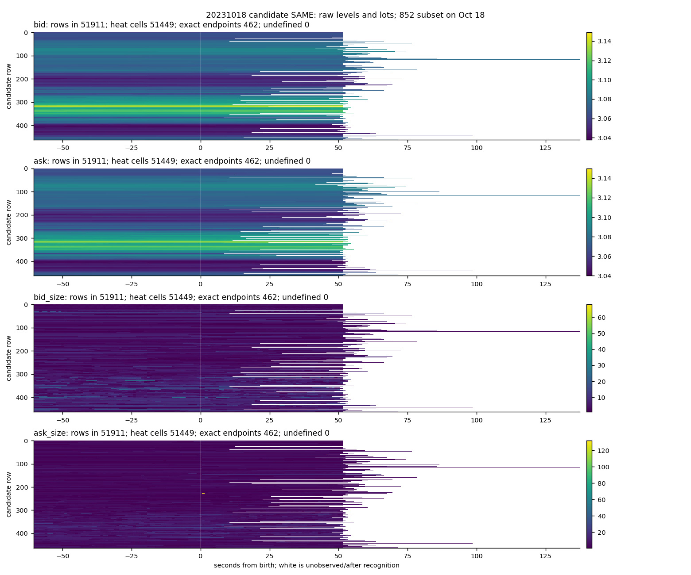
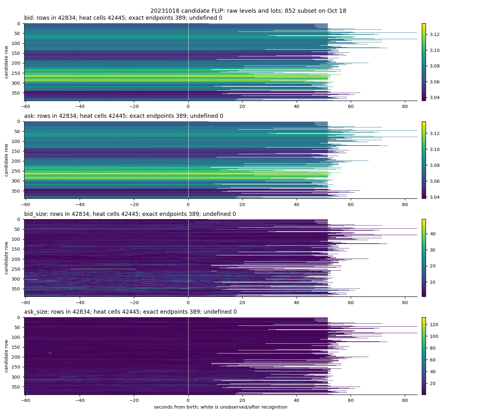

# Native dipole research findings

## Data first

Part 1A tables: [every candidate and operand](tables/20231018-candidate-operands.csv), [every candidate/control path member](tables/20231018-path-members.csv), [all 288,144 path observations](tables/20231018-paths.csv.gz), [raw cases](tables/20231018-case-raw-records.csv.gz), and [figure reconciliation](tables/20231018-figure-reconciliation.csv). The workbook contains the complete review tables; the longer observations remain lossless compressed CSV.

All 36 Part 1A figures are in `figures/`: candidate, control1 and control2; SAME, FLIP and NO_PREDECESSOR; quotes, actions, signed ratio and fractional recognition endpoints. The reconciliation has 270 panel rows. Each heat strip shows actual levels or one-interval lots. Its companion endpoint plot retains the fractional final observation. White space after recognition is not a zero. Ratio undefinedness is retained explicitly.

## Measurements

863 archived candidates were read. Their original coverage labels reconcile as 59 served by the October 17 UTC tape, 793 by October 18, and 11 seam exclusions. The primary figures use the original 852; the archived full-session group source additionally supplies paths for all 11, retained in the tables as a supplement. 583,688 completed groups were checked against 771,787 raw records using cursor, receive clock and F_LAST. All 863 strict-prebirth quote operands and recognition quote/clock checks agree with the saved candidate file.

There are two matched controls per candidate, 1,726 total and 1,532 distinct anchors. Matching uses the same archived session, positive spread bucket (one, two, or at least three ticks), and trailing-60-second trade-count quintile. Activity quintiles are computed within each spread regime, with deterministic seed 1401. Control anchors inside any candidate's requested interval are excluded; their wider windows can still overlap other windows. Control reuse and overlapping events preclude treating rows as independent trials. Calendar times are join coordinates only.

Paths use integer-second observations from minus 60 to recognition and the exact recognition endpoint. At offsets through zero, the cutoff is one nanosecond before the boundary. Quote levels are the last completed group at the cutoff. Action quantities are summed over successive cutoff intervals using the containing group close; adds, cancels, fills, modify message sizes, and wire-side trade lots are separate columns. Fills and linked cancel messages are not additive independent executed volume. The first interval has one extra second of source prehistory. Signed ratio uses only completed full-second bins; no rescaling or smoothing is applied. Full exact raw records for an earliest case of each observed SAME/FLIP and in/against/flat alternative, plus its two controls, are retained with tape day, record index, cursor, integer receive time and order ID.

All 863 birth-to-recognition quote paths include 382 in the birth direction, 278 against, and 203 flat. These are the expanded full-session-source denominator; the original 852 remains the chart denominator. The saved member table retains each orientation and each alternative without averaging.

## Interpretation

SPECULATIVE: These descriptive paths can distinguish quote relocation, changing displayed size and incoming trades. They cannot identify participant intent. The two control selections characterize control-choice variation only. No family, input or target is removed.

## Handoff

Part 1B, Part 2 and Part 3 are still running. Questions raised so far: how much of the path contrast depends on a control anchor being a wall-clock cutoff versus a group close, and how often are recognition endpoints reached only after a trade-free interval?
