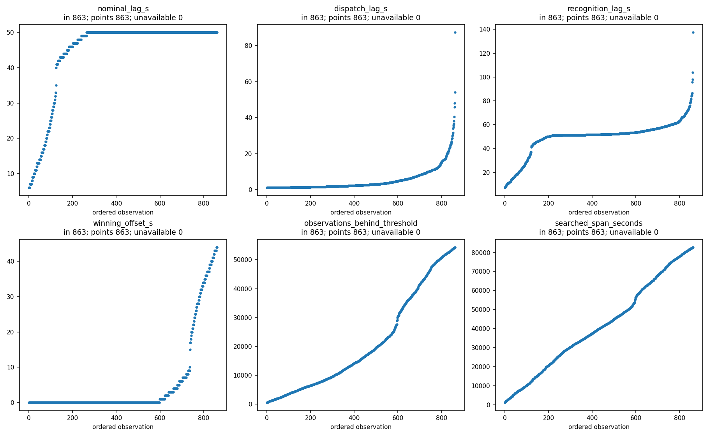

# Native dipole research findings

## Data first

All generated artifacts are local under `E:/Markets-native-dipole-agent-pass/agent-pass/`. Publication to Ccode's three-tier repository layout is pending its configured destinations. No AWS/S3 is used. The two original October 18 data commits predate the storage change and are disclosed in PROGRESS.md; no later data or chart is committed to Markets. Links below describe local artifacts, not newly published repository files.

[Review workbook](research-tables.xlsx). The workbook contains complete review tables; long per-second and pair-distance observations remain compressed CSV. Every path remains individually observable, with no smoothing, amplitude normalization or across-path average.

Per date, use `tables/<date>-paths.csv.gz`, `-path-members.csv`, `-candidate-operands.csv`, `-cases.csv`, `-case-raw-records.csv.gz`, `-detector-all-comparisons.csv`, `-birth-differences-<variant>.csv`, `-lag-measurements.csv`, `-all-hierarchy-merges.csv`, `-pair-distances-<representation>.csv.gz`, `-grouping-members.csv`, `-operator-residuals.csv`, `-life-measurements.csv`, and `-life-paths.csv.gz`. All named missed/added and undefined rows are retained.

Every figure has a panel-level CSV reconciliation: `-figure-reconciliation.csv`, `-detector-figure-reconciliation.csv`, `-part2-figure-reconciliation.csv`, `-part3-figure-reconciliation.csv` when available, plus `crossday-figure-reconciliation.csv`. Heat-strip reconciliation separates integer-second cells, fractional endpoints in companion plots, and undefined values. The original 852-candidate October 18 subset is used for its primary heat strips and hierarchy; the all-live cross-day plots and mechanism tables explicitly include the 11 seam supplements.

Each date has 36 birth-path figures, split candidate/control1/control2 and SAME/FLIP/NO_PREDECESSOR. Quotes, touch sizes, adds/cancels/fills/modify sizes by wire side, wire aggressor lots, signed ratio and exact recognition endpoints have separate panels. Structure figures show all pair distances, all merges and all retained path coordinates. Operator figures show every residual, never a mean line. Figures allocate at least one native image pixel per heat-strip row; image viewer rescaling is separate from the source PNG.

## Confirmed measurements

### Population and birth-aligned paths

|      day | scope            |   candidates |   live |   finalization_only |   path_rows |   controls |   groups |   native_matches |   completed_group_missed |   completed_group_added |
|---------:|:-----------------|-------------:|-------:|--------------------:|------------:|-----------:|---------:|-----------------:|-------------------------:|------------------------:|
| 20231002 | partial_archived |          741 |    741 |                   0 |      254025 |       1482 |   600291 |              741 |                        5 |                       5 |
| 20231003 | full_archived    |          833 |    832 |                   1 |      283542 |       1664 |   653912 |              833 |                        5 |                       5 |
| 20231017 | partial_archived |          741 |    740 |                   1 |      253764 |       1480 |   635170 |              741 |                       11 |                      10 |
| 20231018 | full_archived    |          863 |    863 |                   0 |      288144 |       1726 |   583688 |              863 |                       21 |                      24 |

The populations are the archived Native candidates, not the separate 839/857/830/890 full-session research detections. October 2 and 17 remain partial. October 3 and 17 each retain one finalization-only birth with no live recognition. Exactly 3,176 live candidate paths and 6,352 paired controls generate 1,079,475 path observations. The archived group source allows the 11 original October 18 seam exclusions to be retained as a separately labeled supplement; the original 59+793+11 coverage partition is unchanged.

At each anchor, the path starts at minus 60 seconds and ends at the exact candidate recognition delay. Quote state is the last completed group by the cutoff. At offsets through zero the cutoff is one nanosecond before the boundary; later offsets use the exact boundary. Action lots are summed over successive cutoff intervals and attributed to the containing completed group. The first interval uses an extra second of prehistory. The signed-ratio panel uses fully closed second bins. Fills and their linked cancels remain separate message categories; they must not be added as independent execution volume. Modify columns are message sizes, not inferred net depth changes.

Two deterministic control draws (seed 1401) match the archived session, positive spread bucket (1, 2, 3+ ticks) and trailing-60-second trade-count quintile within spread. Integer-second anchors inside any candidate study interval are excluded from the control pool. Controls retain the case duration and case SAME/FLIP label for paired comparison. Thirteen October 18 control anchors lie in the archived book prefix before the Native flow series starts; their book paths remain valid, while flow and life measurements are explicitly unavailable. A negative-index alias in the first operator calculation was corrected; all 289 superseded transitions, including 26 apparent recurrence discrepancies, remain in a labeled diagnostic table. They can be reused and their wider intervals can overlap; these observations are not independent trials. Matching-audit tables independently recover each anchor's actual regime/activity bucket. These activity bins organize controls; they do not normalize dipole paths or admit/remove research families.

There are 21 traced candidate/control members per date: an earliest candidate in each observed orientation/quote-direction alternative, with both controls. Raw-record totals are 6,161/1,483/5,345/3,122. Traces preserve tape day, source record index, cursor, receive nanoseconds, action, side, price, size and order ID. The case is an example of its cell, not a replacement for the cell distribution.

### Detector recovery and clocks

|      day | variant         |   recorded |   recovered |   matched |   missed |   added |   nominal_exact |
|---------:|:----------------|-----------:|------------:|----------:|---------:|--------:|----------------:|
| 20231002 | completed_group |        741 |         741 |       736 |        5 |       5 |             735 |
| 20231002 | native_action   |        741 |         741 |       741 |        0 |       0 |             741 |
| 20231003 | completed_group |        833 |         833 |       828 |        5 |       5 |             827 |
| 20231003 | native_action   |        833 |         833 |       833 |        0 |       0 |             833 |
| 20231017 | completed_group |        741 |         740 |       730 |       11 |      10 |             728 |
| 20231017 | native_action   |        741 |         741 |       741 |        0 |       0 |             741 |
| 20231018 | completed_group |        863 |         866 |       842 |       21 |      24 |             840 |
| 20231018 | native_action   |        863 |         863 |       863 |        0 |       0 |             863 |

The recovered rule is a trailing finite-observation 85th percentile after the source's 900-second and 600-observation warmup, a plus/minus-five-second local maximum of absolute flow, and prominence against the original baseline median at birth minus 30 through minus 10. Qualifying peaks compete in a 45-second window. Highest prominence wins, magnitude breaks ties, and earliest observation resolves a complete tie. Nominal availability is window-open plus 50 seconds; the selected winner enforces a 45-second refractory. These are recovered detector parameters, not new research acceptance thresholds. The original baseline is reproduced only to audit the detector; it does not smooth the research paths.

Native action-time quote classification reproduces every archived birth and nominal availability on all four dates, including finalization-only nominal times. All six recorded operand columns agree at 1e-12 absolute floating tolerance; all live recognition clocks agree as exact integers. The supplied completed-group series uses another quote-classification reference and therefore has the explicitly listed missed/added births. Its mismatch is not evidence that the recorded Native detector is unrecoverable.

For every one of the 3,178 births, nominal lag = 50 - (winning birth second - window-open second). Thus it is a fixed selection-window close with a variable winner position. Actual live recognition is the first group close in a second later than nominal availability. On October 18, nominal lag ranges 6 to 50 seconds (median 50), dispatch wait 1.000046 to 87.367894 seconds (median 2.406826), and birth-to-recognition 7.059875 to 137.367894 seconds (median 51.673379). All individual observations and the other days' distributions precede this description.

### Structure without a preset cluster count

|      day | representation   |   candidates |   complete |   undefined_rows |   groups_at_largest_gap |
|---------:|:-----------------|-------------:|-----------:|-----------------:|------------------------:|
| 20231002 | signed_ratio     |          741 |        177 |              564 |                     177 |
| 20231002 | touch_lots       |          741 |        741 |                0 |                       2 |
| 20231002 | quote_levels     |          741 |        741 |                0 |                       2 |
| 20231002 | wire_trade_lots  |          741 |        741 |                0 |                       2 |
| 20231003 | signed_ratio     |          832 |        209 |              623 |                       2 |
| 20231003 | touch_lots       |          832 |        832 |                0 |                       2 |
| 20231003 | quote_levels     |          832 |        832 |                0 |                       2 |
| 20231003 | wire_trade_lots  |          832 |        832 |                0 |                       3 |
| 20231017 | signed_ratio     |          740 |        159 |              581 |                     159 |
| 20231017 | touch_lots       |          740 |        740 |                0 |                       2 |
| 20231017 | quote_levels     |          740 |        740 |                0 |                       3 |
| 20231017 | wire_trade_lots  |          740 |        740 |                0 |                       5 |
| 20231018 | signed_ratio     |          852 |        185 |              667 |                     185 |
| 20231018 | touch_lots       |          852 |        852 |                0 |                       4 |
| 20231018 | quote_levels     |          852 |        852 |                0 |                       2 |
| 20231018 | wire_trade_lots  |          852 |        852 |                0 |                       4 |

The representation preserves every integer-time coordinate from minus 60 through plus 5 seconds. Signed ratio, touch lots, quote levels and wire-trade lots are analyzed separately because their units differ. Cityblock distance is a sum of coordinate differences, with no standardization, phase warping or averaging of paths. Every pair distance and every single-linkage merge is retained. The displayed partition uses the largest gap between adjacent merge heights (including zero before the first merge); all other cuts remain in the merge table. Undefined ratio paths are retained as explicit availability patterns and are not imputed.

The 177/185/159 singleton partitions in three signed-ratio runs occur when the largest gap precedes the first merge. They are not 177/185/159 established natural types. Touch-size partitions put 740/831/739/849 members in the largest group on October 2/3/17/18 respectively, with the remaining 1/1/1/3 in singleton groups. That large group contains both SAME and FLIP. Different representations and cuts produce different partitions; this pass establishes no unique number of natural groupings.

### Governing-form attempts and retained counterexamples

All forms were recorded before their execution. Exact recurrence is distinguished from explanatory hypotheses. The complete candidate and both control residuals are in the operator tables. The table below reports counterexample counts / defined candidate rows, keeping SAME and FLIP separate. Flat quote outcomes count as a distinct observed sign; undefined inputs do not become zero residuals.

|      day | orientation   | fixed_50s_nominal_lag   | flow_sign_determines_quote   | depth_sign_determines_quote   | monotone_magnitude_decay   | constant_signed_numerator   |
|---------:|:--------------|:------------------------|:-----------------------------|:------------------------------|:---------------------------|:----------------------------|
| 20231002 | FLIP          | 103/353                 | 201/353                      | 223/353                       | 200/353                    | 353/353                     |
| 20231002 | SAME          | 112/387                 | 215/387                      | 235/387                       | 219/387                    | 387/387                     |
| 20231003 | FLIP          | 122/383                 | 213/383                      | 225/383                       | 208/383                    | 383/383                     |
| 20231003 | SAME          | 126/448                 | 288/448                      | 295/448                       | 229/448                    | 448/448                     |
| 20231017 | FLIP          | 94/353                  | 193/353                      | 230/353                       | 189/353                    | 353/353                     |
| 20231017 | SAME          | 100/386                 | 219/386                      | 255/386                       | 214/386                    | 386/386                     |
| 20231018 | FLIP          | 131/390                 | 223/390                      | 209/390                       | 217/390                    | 390/390                     |
| 20231018 | SAME          | 132/472                 | 257/472                      | 265/472                       | 246/472                    | 472/472                     |

The signed-net rolling relation N(s)=N(s-1)+buy(s)-sell(s)-buy(s-20)+sell(s-20) has zero residual on every retained life transition, including both matched-control draws. This is an arithmetic identity of the 20-second construction, not an independently discovered market law. Fresh and expired buy/sell operands are retained separately.

The fixed-50-second lag assertion has the listed exceptions and is replaced, for description, by the exact window-position identity above. Flow-sign and depth-sign determine-one-quote-direction assertions have contrary and flat cases on every date, as do the controls. Monotone magnitude decay has individual rebounds; no single monotone life curve represents those paths. Constant numerator has counterexamples throughout; because the operational ending changes sign, this test is partly conditioned to contradict a constant numerator. No form or input is removed from future study.

### Verification

|        day |   candidates |   exact_live_recognition_clocks |   finalization_only |   path_rows |   matched_path_anchors_checked |   figure_panels |   life_transition_rows |
|-----------:|-------------:|--------------------------------:|--------------------:|------------:|-------------------------------:|----------------:|-----------------------:|
| 2.0231e+07 |          741 |                             741 |                   0 |      254025 |                           2223 |             342 |                  90556 |
| 2.0231e+07 |          833 |                             832 |                   1 |      283542 |                           2496 |             342 |                 103968 |
| 2.0231e+07 |          741 |                             740 |                   1 |      253764 |                           2220 |             342 |                  86559 |
| 2.0231e+07 |          863 |                             863 |                   0 |      288144 |                           2589 |             342 |                 107181 |

The original detector was independently checked on plateau, quiet and variable synthetic streams: 27/24/35 outputs agree in every operand and clock. All 2,473,061 saved groups reconcile to raw cursor/receive/F_LAST coordinates. Usable two-sided action-time books agree at 2,473,057 closes; four initial incomplete books remain outside that two-sided check. Figure reconciliation, unique coordinates, matching strata, undefined residuals, and life-transition partitions are asserted in `verify_all.py`. A read-only parent review independently confirmed operands, live clocks, nominal-lag identity, path row totals and case counts.

Part 3 has not yet run in this checkpoint; its code is prepared.

## Interpretation (separate from measurements)

SPECULATIVE: A fixed selection window plus variable group arrivals explains the measured clock accounting. It does not establish that price or book state causes a dipole. The recovered Native source and completed-group source are alternative flow measurements and remain separate.

SPECULATIVE: The operational lifetime is the first third consecutive second with flow opposite the anchor sign, or observation through tape end if right-censored. Undefined anchor direction has no lifetime. This analyst-defined convention makes one reproducible life/decay comparison; it is not a recovered natural lifetime and does not identify participant intent. Alternative persistence lengths and other endpoints remain open, with no current rule promoted.

SPECULATIVE: The hierarchy currently describes representation-dependent similarities and sparse extremes, not a stable taxonomy. Control reuse, overlapping paths, incomplete ratio histories, and four discovery dates limit claims of independent replication. Recurrence arithmetic cannot establish predictive or causal information by itself.

## Handoff

- Do the small isolated touch-size groups reflect single unusually displayed queues, replenishment, or another book episode? Trace their exact order histories before naming a mechanism.
- How do event identities change when action-time classification and prior-completed-quote classification disagree, especially around within-group quote changes? The full missed/added lists isolate the cases.
- How much of recognition delay is ordinary quiet-group waiting versus the selection competition, and which raw event definitions preserve a comparable identity?
- Which within-lag orderings repeat within each spread/activity stratum after accounting for reused controls and overlapping windows?
- How do life descriptions change under explicitly different endpoint conventions without imposing one as a natural boundary?
- Can partial October 2/17 populations be extended with comparable archived Native definitions, while retaining the current partial populations as their own results?
- Optional M3 crypto comparison was not run; no crypto transfer result is claimed.

All candidate forms, inverse paths, flat outcomes, undefined cases and recorded inputs remain available. Storage handoff is pending Ccode's actual configured layout; local artifacts will be routed by immutable versions and SHA256 once supplied. PR #15 remains draft and unmerged.
