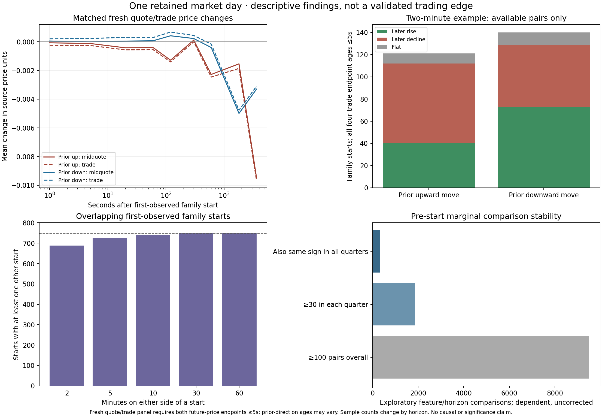

# Completed descriptive Julia findings

The enriched descriptive batch completed successfully on October 22, 2026. It retains all 749 first-observed structural families, all 13 historical concepts and their separate series, all 99 registry identities/dispositions, the confirmed second set and timestamped instrument prices. This is one retained market day, October 17–18, 2023. A first-observed structural family is not a proven original order birth.

The results show horizon-dependent reversal/continuation, substantial family overlap, and sensitivity to using transaction prices versus midquotes. They do not establish a trading edge, causal influence, or the joint nonlinear effects of the market layers. The separately authorized nonlinear model comparisons use these frozen inputs to investigate those questions.

## Direction, flat outcomes and horizons

The following example conditions on the price change in the 120 seconds strictly preceding the first start. All four relevant transaction-price endpoints must have observation ages no greater than five seconds. Every family remains in the master dataset; counts below are the available pairs for each calculation.

| Prior direction | Later horizon | Available pairs | Later rise | Later decline | Flat | Mean price change |
|---|---:|---:|---:|---:|---:|---:|
| Up | 1 second | 165 | 50 | 58 | 57 | −0.0002303 |
| Down | 1 second | 182 | 69 | 35 | 78 | +0.0002363 |
| Up | 20 seconds | 128 | 40 | 69 | 19 | −0.0008281 |
| Down | 20 seconds | 143 | 62 | 47 | 34 | +0.0003427 |
| Up | 120 seconds | 121 | 40 | 72 | 9 | −0.0018843 |
| Down | 120 seconds | 140 | 73 | 56 | 11 | +0.0008500 |
| Up | 600 seconds | 112 | 42 | 67 | 3 | −0.0020000 |
| Down | 600 seconds | 120 | 44 | 68 | 8 | −0.0004167 |
| Up | 3,600 seconds | 111 | 33 | 77 | 1 | −0.0147838 |
| Down | 3,600 seconds | 121 | 56 | 64 | 1 | −0.0043223 |

All nine horizons—1, 5, 20, 60, 120, 300, 600, 1,800 and 3,600 seconds—are saved. The two-minute example is not a selected prediction outcome or a truncation of the retained sequence. At ten minutes the prior-down cohort leans toward continuation again. The one-hour declines in both directional cohorts can reflect the day's broader price path; they do not isolate a family-specific effect.

## Transaction prices versus the book

On matched observations with fresh current and future transaction/quote endpoints, the average one-second change after a prior up move was −0.0002418 in transactions versus −0.00007190 in midquotes (306 pairs). After a prior down move it was +0.0002058 versus +0.00005217 (345 pairs). Thus the mean short reversal is approximately 70–75% smaller in midquotes in these paired cohorts. This is consistent with some transaction-price bounce; it does not prove its entire cause. These cohorts have different freshness requirements from the four-endpoint table above.

Quote and trade sign differences, bid/ask/mid changes, source ages, source ordinals, separate bounds and horizon-specific pair counts are saved in `enriched-v2/quote_trade_pairs.csv.gz` and `quote_trade_summary.csv`. Units were checked against original `price_raw/1e9`. No post-session flat prices were invented. A quote movement alone does not establish an executable profit after spread, fees, latency and slippage.

## What the individual layers suggested

Pre-start bid-side full-book depth concentration had a marginal correlation of approximately −0.564 with the one-hour transaction-price change across 406 available pairs. The four quarter correlations were approximately −0.702, −0.547, −0.694 and −0.600, but their counts were 10, 24, 254 and 118. That is a lead with sparse early support, not a stable out-of-sample result.

Other seemingly strong flow relationships changed direction: the five-minute buy-aggressor quantity's one-hour association was positive in quarters one/two/four and negative in quarter three. Repeated feature aliases also share numerical series; they are not independent confirmations.

Of 9,504 strict-prestart feature/horizon comparisons having at least 100 pairs overall, 1,866 had at least 30 pairs in every quarter; 327 of those retained the same correlation sign in all quarters. These are dependent, uncorrected exploratory comparisons. Neither those counts nor the saved 425,340 total marginal comparisons measure joint nonlinear interactions or statistical discoveries.

## Prebirth, exhaustion and dependence

Pre-start changes are compared over 120/300/600 seconds with periods ten minutes before and after each target start. Actual pre-start endpoints are strictly before the start; onset measurements remain separate. Median differences between onset and nearby transaction-price changes were zero at the shorter horizons in the saved unfiltered available-pair comparisons. This does not establish a distinct prebirth effect, and the nearby periods can contain other families.

688 of 749 starts had another first-observed start within 120 seconds on either side; 740 had one within 600 seconds. Mean neighboring counts were 6.51 and 24.66 respectively. At 30/60 minutes all 749 overlapped other starts. Consequently these observations cannot support independent-trial significance calculations. Reversal and deceleration proxies are not established exhaustion; age sensitivity, chronology, broader market moves and overlapping activity still matter.

## Additions and remaining gaps

The batch added 78,389 exact-index lifecycle rows from ten sections and 163,873 context links, with zero future/instrument eligibility rejections. It retained 1,021,088 categorical/source-quality observations, added extended published vintages/weather history and 20,223 quote endpoint windows, and reconciled 20,972 structural counter checks with zero mismatches. Separately counted complete action/side strings supplied 64,926 directly observed zeros; original missing dictionary keys were preserved.

The final added-measurement table contains 7,615,124 rows; these are context/feature observations, not independent events. The joint model input builder records 1,886 contemporaneous feature columns plus their available causal changes. These columns are not 1,886 independent market layers. All 99 registry roles remain pinned, including nonnumerical, withheld, retired and unavailable dispositions.

Remaining missingness includes genuinely undefined far-side flow/step fields, absent earlier publications, weather fields with no prior numeric observation, unverified ladder price scales, and censored price endpoints. The original far-side queue-age field is valid in 495,733 of 771,787 source rows; its other dispositions are 188,099 NOT_F_LAST, 51,976 NO_FLOW and 35,979 SIDE_UNDEFINED. Both-side native book ages are separate available observations, not replacements for an undefined far side. Historical temperature observations were already recovered separately at all stations/family pre-start contexts; current-report M values remain M.

The gap ledger is `enriched-v2/remaining_gaps.csv`. Constant slow external observations remain retained; one day cannot identify their varying effects. Candidate/recognition/response labels, terminal knowledge, IDs and clocks remain provenance and are not numerical input features.

## Reproduction and saved evidence

`scripts/run_enriched_once.jl` is the single enriched descriptive batch, gated on all additions. The source database is read-only. Actual outputs, source receipts, runtime Project/Manifest, all marginal comparisons and negative/constant/inconclusive results are saved under `enriched-v2/`; the preceding completed baseline is under `descriptive-v1/`. The large change table is split into numbered gzip parts; concatenate in order before decompression. `result_manifest.json` records source and transport hashes.

Durable private archive: `s3://bento-568968024170-us-east-2-an/frankie/family-prebirth/20261022/family-enriched-descriptive-v2-4012d169.tar.gz` (245,482,113 bytes; SHA256 `4012d169f19f9e0c865efd937b883bffae4f16967e45be55e6f2f47a6b22e87b`). Download, per-file hashes and decompressed hashes were verified. The earlier input bundle remains unchanged. The historical Python draft test remains unimplemented and is not a passing-functionality claim.

