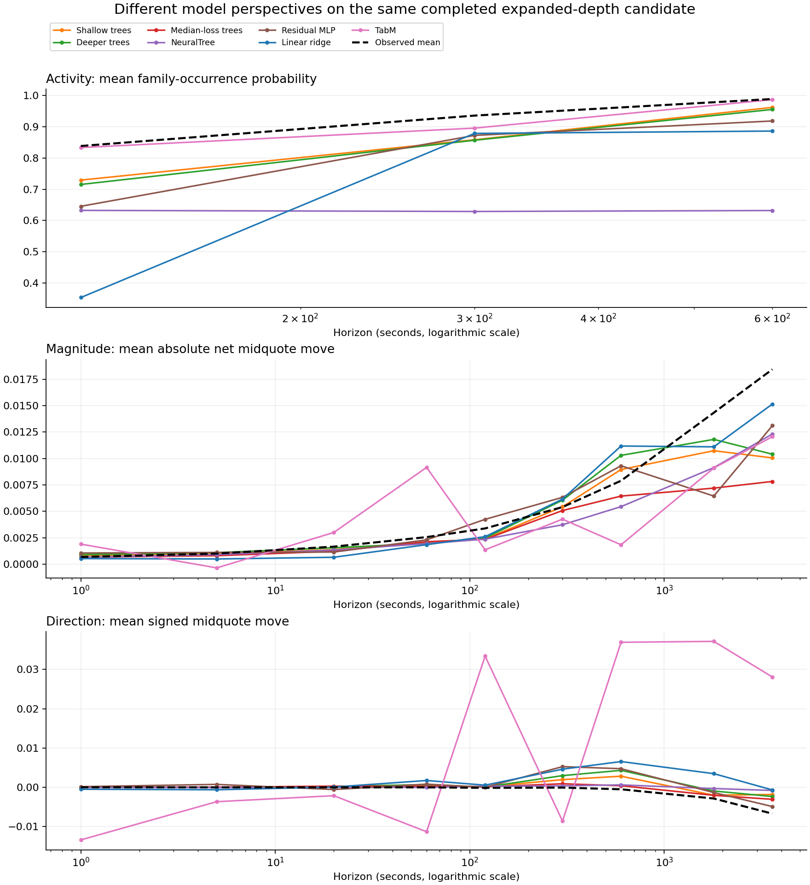
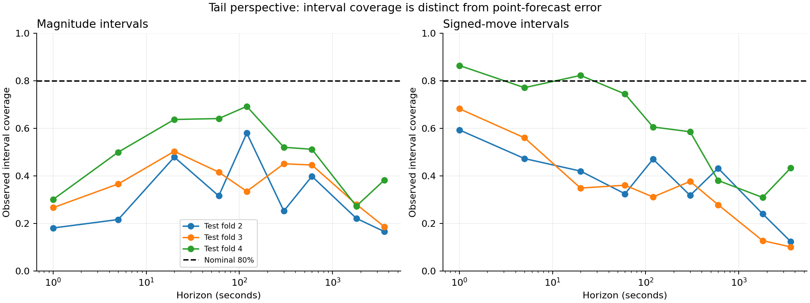

# Family market research from complementary model perspectives

Completed expanded-depth family research · October 23, 2026 UTC / October 22 Eastern

**Current research unit:** the user clarified that averages inform investigation but do not supply a trade signal. The [instance-by-instance records](../instance-market-review-20261023/instance-by-instance.md) now preserve all 749 events separately. Begin with the [exact instance 375 replay and next matching instance](../instance-market-review-20261023/instance-375-review.md). The aggregates below remain supporting context.

The useful result is a layered description of this market day: **how active the selected family contexts are, how much price moves, how it travels, which book and historical conditions accompany those moves, and where direction and uncertainty remain unresolved.** Each model contributes to that description. Their disagreement is part of the evidence.

For a concrete example, the ten-minute held-out quote outcomes have mean absolute movement of **0.007900** but mean signed i see your averagwesa movement of only **−0.000537**. Substantial movements in opposite directions can cancel in the average. The separate trade-path view then shows movement inside the window that endpoint forecasts alone cannot describe. A fuller account needs both kinds of information.

The expanded book is substantively present: **125 of 126 shallow/deeper tree fits used fields beyond book level 10**, with a fitted split reaching rank 265. Queue ages, queue concentration, sizes, timing, curve information and their histories appear in conditional relationships. Those relationships change with the question and horizon. This is more informative than a universal claim that one model or data block is best.

The combined picture also has limits. The nominal 80% tail bands contain far fewer than 80% of outcomes at most horizons. Some magnitude forecasts are negative, which is invalid for an absolute change. The unsupervised groups are highly uneven. These outputs help identify what the current picture misses; they cannot be treated as equally reliable inputs to an average.

## Evidence and scope

This report uses the **finished candidate**, with all **2,097 mandatory fits** complete: 1,908 core fits and 189 neural fits. It supersedes the earlier interim 2,094-key readout. The final saved predictions contain 1,181,946 core rows and 118,203 neural rows, including refits and reference forecasts. The accompanying analysis checks 63 matching outcome/horizon/fold cohorts. All 63 saved label-alignment audits pass.

The candidate matrix has 1,154,928 columns, including 80,839 expanded native/ROOT current fields and 200,868 history-current fields. That is a large representation, not 1.15 million independent measurements. There are **749 families and 3,745 selected phase samples from one retained October 17–18, 2023 market day**. Regression training cohorts contain only 110–1,376 available rows. Three chronological held-out folds belong to that same day.

The original preprocessing is fitted on training rows only. Family purge, outcome-horizon purge, a 600-second embargo, integer nanosecond clocks and strict availability/cursor rules remain in place. Unavailable targets remain recorded as unavailable; they do not erase families from the retained master data. Price models require fresh current and future quote endpoints, with quote ages no greater than five seconds.

This report compares perspectives **within the expanded candidate**. Earlier fitted models with incomplete market depth are not used to judge its model families. The linear ridge model here was also refitted on the expanded candidate. Constant/frequency reference forecasts are retained in the appendix as marginal context, not as substitutes for the missing market structure in older runs.

**Semantic coverage remains `NOT_PASSED`.** The complete knowledge/99-plane consumer ledger and unit mappings remain unresolved. Expanded depth and finished numerical coverage do not certify those semantics. V3 stays frozen. First-observed family starts are not proven original order births. In this selected cohort, 688 of 749 starts have another start within ±120 seconds and 740 within ±600 seconds, so observations and horizons overlap heavily.

Sources: [input receipt](source/model_input_receipt.json), [core receipt](source/model_run_receipt.json), [neural receipt](source/neural_run_receipt.json), [chronological cohorts](source/chronological_splits.csv), [alignment audits](source/heldout_alignment_audit.csv).

## What each perspective contributes

| Perspective | What it asks of the same data | What this run adds | Interpretation boundary |
|---|---|---|---|
| Linear ridge | Is there a broad additive response across the available fields? | A linear view to compare with threshold and interaction responses. | Correlated, numerous columns and limited samples constrain identification; no coefficient attribution is claimed here. |
| Shallow EvoTrees | Do a few conditional thresholds describe different responses? | Inspectable queue/depth/timing relationships and the reference structure for block-removal refits. | Training split gain is not held-out importance or causality. |
| Deeper EvoTrees | Does a more layered conditional structure describe something additional? | Additional fitted paths involving deep queues, sizes and external history. | More elaborate structure also creates sparse combinations; support must be checked. |
| MAE-loss EvoTrees | What does the typical conditional move look like? | A median-oriented view alongside the squared-loss models' mean-oriented view. | Mean and median forecasts answer different questions. |
| Quantile EvoTrees | How asymmetric or dispersed could the outcome distribution be? | Separate lower and upper tail estimates, exposing gaps hidden by point forecasts. | Their recorded intervals are poorly calibrated here. |
| NeuralTree | What does a smooth learned tree representation retain? | A comparatively compressed response; occurrence means stay near 0.63 across the three horizons. | Smoothness can also mean insufficient responsiveness; no feature-specific neural mechanism was extracted. |
| Residual MLP | What can a distributed nonlinear representation express? | A distinct pattern across horizons, including more negative average one-hour direction than several other views. | Some invalid magnitude outputs and an unresolved repeatability discrepancy remain. |
| TabM | What does the tabular architecture's internal ensemble representation express? | A separate response shape: near-matching aggregate occurrence rates coexist with large directional offsets. | Internal ensembling does not make its outputs independent evidence; invalid magnitude forecasts are retained. |
| PCA / k-means | Which contexts look similar without using the future target? | A check on context geometry and whether different states actually have held-out support. | Cluster labels do not supply economic explanations by themselves. |
| Source/history removal | What changes when a whole block is unavailable to an otherwise comparable refit? | Evidence about incremental block usefulness by outcome and horizon. | This is conditional on the shallow-tree refit and correlated substitutes. |
| Observed trade paths | What happened between the endpoints? | A path perspective that distinguishes back-and-forth activity from net movement. | Transaction paths and fresh-midquote targets use different measurements and availability cohorts. |

No new combined predictor, weighting rule, fitted model or trading strategy was produced for this report. The synthesis combines interpretations and matched diagnostics.

## Activity: when the selected contexts are busy

The occurrence question is whether **any first-observed family for the instrument appears within the horizon**, at contexts selected around family starts and nearby times. It is not the probability of an arbitrary market event at an arbitrary timestamp. Selecting contexts around starts itself raises occurrence rates, especially for windows that include those starts.

At two minutes, the observed occurrence fraction is **83.85%**. Mean predictions range from ridge's 35.33%, through NeuralTree's 63.23% and the MLP's 64.54%, to shallow/deeper trees' 72.92%/71.53% and TabM's 83.34%. At ten minutes, the observed fraction is **98.90%**: most views rise substantially, while NeuralTree's mean remains about 63.19%.

This separates three questions: the overall activity level, sensitivity to horizon, and which individual contexts receive higher probabilities. Matching the first does not establish the third. For example, TabM's two-minute average is near the observed rate, but its Brier probability error is 0.197323 versus the shallow tree's 0.146995 on the same labels. That contrast identifies a calibration/discrimination issue to investigate; it is not an architecture ranking.

The removal lens adds context: removing native timing increases five-minute occurrence Brier error **9.37%**, and removing weather increases it **8.85%**, with the same direction in all three folds. Removing the book/depth/queue block instead decreases that error **4.36%** in all three. At two minutes, curve removal increases error **6.07%**; at ten minutes it decreases error **5.84%**.

Together, the activity views suggest that timing and broader conditions can describe how these selected contexts evolve, while detailed book information is not uniformly incremental for occurrence. Slow external series may also proxy progression through this single day; these results do not establish a physical weather-to-family mechanism.

Evidence: [probability calibration by fold and bin](tables/occurrence_calibration.csv), [response profiles](tables/model_response_profiles.csv), [all block-removal contexts](tables/all_480_removal_contexts.csv).

## Movement size and path: substantial motion can end with little net direction

The magnitude target is **absolute endpoint-to-endpoint midquote change**. It is not intrahorizon range or realized volatility. At ten minutes, the observed mean magnitude is 0.007900 price units across 1,759 held-out rows:

| Perspective | Mean magnitude forecast |
|---|---:|
| Linear ridge | 0.011181 |
| Shallow trees | 0.008959 |
| Deeper trees | 0.010298 |
| Median-loss trees | 0.006446 |
| NeuralTree | 0.005450 |
| Residual MLP | 0.009311 |
| TabM | 0.001842 |

These averages describe different response levels; they do not measure individual forecast accuracy. The median-oriented model need not reproduce the observed mean in a skewed distribution. The full appendix retains dispersion and errors alongside the means.

The history lens helps explain why a single snapshot can be incomplete. Removing all history increases magnitude MAE **6.37% at five seconds, 14.10% at ten minutes and 1.23% at one hour**, in each case increasing error in all three folds. At two minutes, removal instead decreases pooled error **2.00%**, with mixed fold directions. The changing benefit argues for horizon-specific interpretation of history, rather than declaring every lookback universally useful.

The observed-path lens contributes another part of the picture. Across available recorded trade paths, the ten-minute mean intrahorizon range is **0.017223**, while mean absolute trade endpoint change is **0.008269**. At one hour they are **0.039869** and **0.019283**. Median recorded path efficiency falls from about 0.40 at one second to 0.041 at ten minutes and 0.019 at one hour.

Those summaries describe substantial back-and-forth travel relative to net displacement. They help reconcile active markets and meaningful magnitude with weak or conflicting signed forecasts. They are not a matched causal comparison against the midquote target: available path counts differ, transaction prices differ from quotes, and stale/censored cases remain explicitly recorded.

Evidence: [observed-path summaries](tables/observed_path_perspective.csv), [history and source refits](tables/all_1440_removal_fold_effects.csv), [every point-model perspective](tables/all_144_point_model_perspectives.csv).

## Direction, momentum and exhaustion: retain the disagreement

At ten minutes, the observed signed mean is **−0.000537**, while every point model has a positive mean forecast. Activity and size do not resolve that directional mismatch. At one hour, across the same 1,696 available held-out contexts, the views are:

| Perspective | Mean signed forecast |
|---|---:|
| Observed mean | **−0.006746** |
| Linear ridge | −0.000703 |
| Shallow trees | −0.001862 |
| Deeper trees | −0.002380 |
| Median-loss trees | −0.003101 |
| NeuralTree | −0.000830 |
| Residual MLP | −0.004934 |
| TabM | +0.028089 |

Six views have a negative pooled mean at one hour, but that is **not six independent confirmations** and does not imply sample-by-sample sign agreement. They share the data, and the pooled drift can conceal large differences across chronological segments. TabM's contrary positive offset remains visible rather than being averaged away or excluded after seeing the outcome.

For momentum and exhaustion, the right question is whether predictions and outcomes change with the preceding path, phase and queue conditions. The appendix preserves signed predictions by **prior observed transaction-price direction**, family phase and fold. That prior direction is a transaction-based descriptor, not a fresh-midquote momentum measure. `before_start` is the strict pre-start cutoff; `near_before` and `near_after` are ten-minute offsets. These nearby controls can themselves overlap other family events.

The fitted targets do not directly label exhaustion, identify an event's causal effect, or demonstrate a universal continuation/reversal law. A short-horizon reversal in transactions can include bid/ask effects. The completed expanded-depth models add conditional context to investigate those mechanisms; they do not turn the historical reversal observation into an established tradable edge.

Evidence: [signed phase/prior-direction cells](tables/signed_phase_and_prior_trade_direction.csv), [all phase responses](tables/phase_model_perspectives.csv), [paired model correlations](tables/cross_model_prediction_correlations.csv), [sample-level sign-agreement summaries](tables/cross_model_agreement.csv). Model agreement is descriptive, not a calibrated confidence measure.



The chart uses the same color for each model across panels. It shows pooled response means, not an accuracy ranking. Missing median-loss classification output is intentional: that fit is a regression perspective. Different horizons can have different available label cohorts.

## Deep structure and interactions: the expanded book changes what we can inspect

Of 29,997 fitted tree-feature rows, **16,032 refer to depth ranks beyond 10**. The maximum fitted rank is **265**. Both tree depths use deeper-book fields in almost every fit, with roughly one-third of their training split gain attributed to beyond-level-10 fields. This establishes actual fitted use of the expanded book. It does not establish that any particular deep level has independent predictive importance.

The conditional removal evidence is question-dependent:

| Removed block | Question and horizon | Pooled error change after removal | Fold directions |
|---|---|---:|---|
| Book / depth / queue | Magnitude, 20 s | +1.29% | Higher error in 3/3 |
| Flow / structure | Magnitude, 20 s | +0.48% | Higher error in 3/3 |
| Book / depth / queue | Signed move, 300 s | −4.44% | Lower error in 3/3 |
| Native timing | Signed move, 1 s | −3.80% | Lower error in 3/3 |
| External curve | Magnitude, 1,800 s | +15.47% | Higher error in 3/3 |
| External weather | Magnitude, 1,800 s | +1.00% | Higher error in 3/3 |

Positive means the removed block was incrementally useful to that refit; negative means removal helped. It is entirely possible for queue structure to help describe size while complicating direction in the fixed model. Redundant blocks, small samples and day-specific conditions are alternative explanations. Among all 480 block/history/outcome/horizon contexts, **341 are flat in every fold, 20 worsen in all three after removal, 19 improve in all three, and 100 have mixed or partial effects**. Flat refits do not prove a source is physically irrelevant.

The interaction postprocessor selects candidate pairs using training conditional split gain, then examines observed held-out strata with training quartile thresholds. Of **629 saved contrasts**, **43 have at least ten observations in each of the four low/high corners**. The other 586 fail this support screen or have an undefined contrast. Ten observations is a descriptive support threshold, not a significance test.

Examples below are ordered by corner support, not by favorable held-out effect:

| Conditional pair, using recorded changes | Question | Fold / model | Smallest corner | Observed four-corner contrast |
|---|---|---|---:|---:|
| 120 s change in bid-rank-105 size-weighted FIFO age × ask-rank-33 second-position priority age | Signed 20 s | 3 / shallow tree | 139 | −0.000316 |
| 120 s change in bid-rank-8 size × external-curve trade size | Magnitude 5 s | 3 / deeper tree | 125 | −0.000052 |
| 120 s change in bid-rank-105 FIFO age × bid-rank-5 sixth-position priority age | Signed 20 s | 3 / deeper tree | 79 | −0.000052 |
| Ask-rank-70 FIFO size concentration change × external-curve trade-size history change | Signed 5 s | 3 / deeper tree | 64 | −0.000335 |
| Bid-rank-46 second-position priority-age change × external-curve trade-size history change | Signed 1 s | 3 / deeper tree | 61 | +0.000377 |

The contrast is `HH − HL − LH + LL` in observed outcomes; it is not a return or a model coefficient. The full identifiers, lookbacks, thresholds and corner counts are retained. **No exact pair/outcome/horizon has support-qualified contrasts in more than one fold.** These are queue/curve mechanism candidates for further investigation, with multiple-comparison and overlapping-observation limitations, not replicated interaction discoveries.

Evidence: [depth use by fit](tables/tree_depth_scope_by_fit.csv), [source gain by fit](tables/tree_source_gain_by_fit.csv), [all 629 contrasts](tables/all_629_interaction_support.csv), [43 support-qualified contrasts](tables/supported_interactions.csv), [cross-fold support](tables/interaction_cross_fold_support.csv), [original interaction receipt](source/interaction_analysis_receipt.json).

## Tails and market states: two checks against overconfidence

The q10–q90 models ask a different question from the point forecasts. Their interval is nominally 80%, but reconstructed observed coverage is:

| Horizon | Magnitude coverage | Signed-move coverage |
|---|---:|---:|
| 1 s | 27.01% | 73.42% |
| 120 s | 46.94% | 41.91% |
| 600 s | 46.45% | 32.23% |
| 3,600 s | 24.41% | 20.34% |

The magnitude intervals never reach 80% in any individual fold/horizon. Signed intervals do in a few cells, but coverage deteriorates sharply at longer horizons. There is one crossed magnitude interval. These bands do not yet provide calibrated risk limits. The recorded data do not isolate how much undercoverage comes from distribution shift, representation, model fitting or the target's distribution.



PCA/k-means checks whether contexts separate without future labels. The three-cluster fit assigns **3,515 of 3,745 contexts to one cluster (93.9%)**. Both small clusters occur only in the first chronological quarter; every later-quarter context falls in the same large cluster. This particular fit therefore provides no held-out three-state separation.

The five-cluster fit has sizes **637, 36, 70, 2,816 and 186**. Two clusters again occur only in the first quarter; three have later support. That permits descriptive state-conditioned prediction summaries, but support is very uneven. The original PCA/clustering transformation was trained on selected phases in the earliest quarter. Phase design and missingness can affect the geometry. Loadings are retained in the canonical archive but were not retrieved for this report, so labels such as “absorption regime” or “thin-book regime” would be invented.

Together, the tail and state views warn that a compact point forecast can hide dispersion and changing context. Neither the current bands nor the cluster labels supply a reliable confidence score for the other models.

Evidence: [all 54 interval checks](tables/quantile_interval_coverage.csv), [cluster membership by quarter and phase](tables/market_state_membership.csv), [state-conditioned model responses](tables/market_state_perspectives.csv).

## Model-specific counterevidence that stays in the picture

Across 15,752 held-out magnitude forecasts per point model, negative forecasts occur **1,824 times for ridge, once for deeper trees, 437 times for the residual MLP and 5,420 times for TabM**. Shallow trees, median-loss trees and NeuralTree have none. Absolute changes cannot be negative. These are preserved as produced, without clipping, retraining or silently removing cases. They limit how directly the corresponding outputs can be interpreted as movement size; they are not a verdict about every possible configuration of an architecture.

The neural fits use the fixed 25-epoch configuration. This report does not diagnose optimization or scaling as the cause of these behaviors. NeuralTree's compressed responses, the MLP's differences and TabM's offsets each identify a different question to investigate rather than a reason to select a winner after the fact.

There is also unresolved **residual-MLP reproducibility evidence for occurrence at 120 seconds, fold 4**. The original and an unnecessary repeat differ by a maximum prediction difference of **0.4313412607**, with log losses **1.5684192762 versus 2.9158903594**. This is not rounding. The original completed attempt remains canonical, both attempts remain saved, and the discrepancy is unresolved. The NeuralTree repeat difference of approximately 0.00000268 does not resolve the separate MLP issue. The [original reconciliation](../joint-models-v4-candidate-20261022/parallel-63/serial-original-reconciliation-20261022.json) retains both results and their authority.

## The fuller picture, and what remains open

The current evidence supports an analysis with several linked dimensions:

1. **Activity:** these event-selected contexts become very likely to contain a first-observed family as the horizon expands. Timing and external context affect the fitted description, with horizon-dependent contradictions preserved.
2. **Movement and travel:** net movement generally grows with horizon, but observed paths travel considerably farther than their endpoints suggest. History adds information in several size contexts, with exceptions.
3. **Conditional structure:** the expanded book supplies actual deep-queue and size relationships, including combinations with curve history. Most candidate interactions lack enough corner support, and none of the support-qualified exact relationships repeat across folds.
4. **Direction:** pooled drift, context-specific movement and forecast offsets differ. A size or activity indication cannot be converted into a directional claim without additional evidence.
5. **Uncertainty:** poor interval coverage, uneven states, output-domain failures and repeatability evidence reveal where the current representation is incomplete or unstable.

Putting those perspectives together means retaining, for each context, activity, net size, path behavior, signed response, conditional book/history evidence and its support. Agreement should be recorded alongside disagreement and calibration. It should not automatically become a vote or an equally weighted average. These views share data and can share errors.

The next scientific questions are whether the queue/curve candidates recur on additional days, whether tail coverage and magnitude-domain validity can be established, whether states have stable held-out meaning, and whether the unresolved semantic mappings and MLP repeatability can be resolved. Those are validation needs, not findings from work that has not run. No new runs or spending were started for this synthesis.

## Complete evidence and preservation

- [Model-by-model appendix: all horizons for every point model](model-by-model-details.md)
- [144 point-model profiles with dispersion, errors and domain checks](tables/all_144_point_model_perspectives.csv)
- [All 717 pooled profiles, including reference forecasts and refits](tables/all_717_model_profiles.csv)
- [All 2,151 fold metrics: 2,097 scheduled fits plus 54 training-median reference rows](tables/all_2151_fold_metrics.csv)
- [All 1,440 source/history-removal fold effects](tables/all_1440_removal_fold_effects.csv)
- [Analysis validation receipt](analysis-receipt.json)
- [Authenticated archive-prefix transport and retained-file hashes](source/transport-prefix.json)
- [Verified save-and-stop completion](../family-save-stop-COMPLETE-20261023.txt)

All four EC2 instances are verified stopped. Their EBS, attempts and frozen snapshot are retained. The complete final A archive and B/C/D shard archives are durably saved, with full SHA256/length verification completed by the callbacks before shutdown. All four result archives use S3 AES256 server-side encryption and the bucket's four public-access blocks are enabled. Retained EBS, snapshots and S3 storage continue to incur charges; compute is stopped. The legacy unencrypted EBS volume was retained untouched, so archive encryption is not a claim that every old disk is encrypted.

Canonical bucket: `frankie-granite42-568968024170-us-east-1`. Final A key:

```text
host-deliveries/family-research-20261022/save-stop/cce6f548f09f50f00caaca396a213e9f2d42d5a7ff85c0644be311eb83e708f4/A-final-1792717045761634343.tar.gz
SHA256 fa195668b0d9ca489639efb60b0c07596c55865dab82d449ba04663a027b6d5d
Bytes 20696923225
```

The local analysis read only the scientific-table prefix of that authenticated archive, retaining 32 files and their individual transport hashes. It did not download or rehash the full archive, restore raw inputs, start instances, rerun fits or run another PCA/finalizer. Bulk tables and learned states remain in the canonical archives; bounded scientific tables, derived evidence and these reports are saved with the research checkout.
