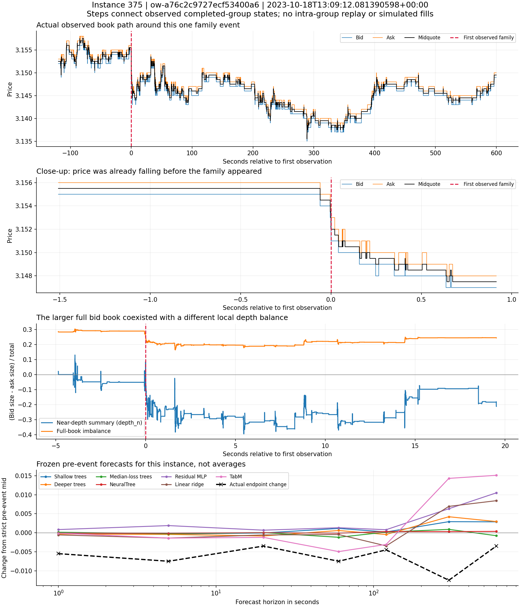

# Individual market episode review for instance 375

The unit here is one first-observed structural family event and its surrounding market sequence. It is not an executed trade. The objective is to inspect what was observable before a possible decision, how the book and flow were changing, what the frozen models said about that instance, and what happened afterward. Across-instance averages provide context; they are not an entry condition.

## Event identity and decision boundary

Family `ow-a76c2c9727ecf53400a6`, instrument `150611`, first appeared on **October 18, 2023 at 13:09:12.081390598 UTC**. It is the 375th of 749 families chronologically, chosen for the original replay before inspecting outcomes. This family recurs four times in the retained day; this review concerns its first appearance.

The strict pre-event decision boundary is receive time **1697634552081390597 ns**, with input cursor cap **303655**. The last eligible completed-group snapshot is source ordinal **233425**, cursor **303645**, known by **1697634552081085486 ns**. That observation is **0.305111 milliseconds** old at the decision boundary. The family group itself, ordinal 233426/cursor 303656, is excluded from this pre-event row.

The replay contains 22,194 consecutive completed-group books from two minutes before through ten minutes after the event. Eighteen checkpoint ladders were extracted from the saved 10,267,320 level rows. Full bid/ask size sums and best-price aliases reconcile at every checkpoint. At these checkpoints the producer's `depth_n` also equals the sum of its first ten price levels. No interpolation, intra-group order replay, simulated fill or fee assumption is inserted.

## What was observable before the event

The strict pre-event book was **3.152 bid / 3.154 ask**, midpoint **3.1530**, spread **0.0020**.

| Recorded pre-event quantity | Bid or buy | Ask or sell | What it says about this particular moment |
|---|---:|---:|---|
| Full displayed book size | 2,081 | 1,223 | More size on the bid side across the entire retained ladder. |
| First ten levels at the checkpoint | 155 | 160 | The nearer book did not share that bid-heavy balance. |
| Aggressor quantity over the preceding 60 s | 126 | 58 | This rolling window was buy-heavy. |
| Aggressor quantity over the preceding 20 s | 39 | 38 | The shorter window was nearly balanced. |
| Aggressor quantity over the preceding 5 s | 13 | 31 | Recent activity had become sell-heavy. |
| Aggressor quantity over the preceding 1 s | 0 | 24 | The shortest window contained only sell-aggressor quantity. |

These are overlapping rolling windows recorded in the same eligible snapshot, not independent votes. The observations suggest a transition from earlier buying toward very recent selling. A larger total bid book by itself did not describe the immediate pressure at the touch. Of the 2,081 bid units, 1,926 lay beyond the first ten levels at this checkpoint.

The pre-event ask at 3.154 contained 25 size across 14 orders, with a front-order age of about 0.003852 seconds. The bid at 3.152 contained 7 size across 5 orders. These are actual queue summaries, not proof that particular orders survived, cancelled or traded. Absolute price must be retained when comparing ladders; rank 1 after the move is a different price from rank 1 before it.

The saved context also contains raw second-set component values, native timing measurements and 62 external-as-of rows. They remain linked in the evidence files. Their presence does not establish that weather, curve conditions or a named knowledge mechanism caused this short price move.

## The sequence makes the timing problem visible

| Position in the sequence | Observed midpoint | Change from strict pre-event midpoint |
|---|---:|---:|
| Last eligible book at the −61 ms checkpoint, last observed at −1.444753 s | 3.1555 | +0.0025 |
| Strictly before the family, last observed at −0.305112 ms | 3.1530 | 0 |
| Family's own completed group at 0 | 3.1525 | −0.0005 |
| Last book by +1 s | 3.1475 | −0.0055 |
| Last book by +5 s | 3.1455 | −0.0075 |
| Last book by +20 s | 3.1495 | −0.0035 |
| Last book by +60 s | 3.1455 | −0.0075 |
| Last book by +120 s | 3.1485 | −0.0045 |
| Last book by +300 s | 3.1405 | −0.0125 |
| Last book by +600 s | 3.1495 | −0.0035 |

The first lower-midpoint update in the final burst occurs about **60.133 milliseconds before** the family's first appearance. The midpoint had therefore already fallen **0.0025** before the strict pre-event snapshot. The family is a marker during an unfolding move, not evidence that the move began at zero.

At the family group, the best bid moved to 3.151 while the ask remained 3.154, widening the spread to 0.003. By the +1 s checkpoint, bid/ask were 3.147/3.148 and the first-ten-level sizes were **129 bid versus 228 ask**. By +5 s they were **121 versus 217**. The local book became more ask-heavy while the full book remained bid-heavy. This is precisely the detail that a single full-depth total can conceal.

The subsequent path includes a partial rebound, another decline and a recovery. The +5 s and +600 s endpoints describe different stages of that path. An entry hypothesis needs a detection clock, reaction/confirmation logic and an exit/invalidation clock; the phrase “sell pressure appeared” does not specify those decisions.

Steps in the first three panels connect observed completed-group states; partial states inside a group remain unobserved. The final panel displays the frozen pre-event predictions for this one instance at discrete horizons. Lines between forecast horizons are visual guides, not an intrahorizon forecast path.

## What the different models said about this instance

All rows below were saved for `375:before_start`, held-out fold 3. The forecasts use the same original strict pre-event information boundary and remain unaltered.

| Perspective | Signed forecast at 1 s | Signed forecast at 60 s |
|---|---:|---:|
| Linear ridge | −0.000569 | −0.000466 |
| Shallow trees | −0.000216 | +0.001143 |
| Deeper trees | −0.000326 | +0.000590 |
| Median-loss trees | +0.000142 | −0.001191 |
| NeuralTree | −0.000073 | −0.000106 |
| Residual MLP | +0.000836 | +0.001327 |
| TabM | −0.000106 | −0.004949 |
| Actual saved endpoint change | **−0.005500** | **−0.007500** |

Several representations pointed slightly down at one second, but their magnitudes did not describe the actual drop. The MLP and median-loss trees had positive one-second forecasts. At one minute the views disagreed on direction; TabM supplied a substantially more negative view of this instance. That does not select it as the general model to use: its other horizons, magnitude-domain failures and the separate MLP repeatability evidence remain part of the research.

The one-second magnitude forecasts also understated this case. For example, the shallow/deeper trees forecast **0.002602 / 0.003021** against an actual absolute move of **0.005500**. The magnitude q90 forecast was **0.002286**, below the realized move. The tail estimate is additional instance evidence about underrepresentation of this burst, not a calibrated entry/risk limit.

The original saved price labels reconcile against the observed replay within 1e-12 at all seven available horizons from 1 through 600 seconds. Thirty-minute and one-hour endpoints remain in the saved forecasts, but are outside this local continuous replay window.

## A candidate to examine one occurrence at a time

This review suggests a case-finding description: **the 60-second window is buy-heavy, the five- and one-second windows are sell-heavy, and total displayed bid size still exceeds ask size**. It was formed while inspecting instance 375; it was not preregistered and is not a validated trade signal.

A screen using only those pre-event measurements finds **50 matching first-family contexts**. All matches are saved chronologically, without filtering on future price changes. Missing measurements have an explicit unknown state. The screen does not pick an entry threshold, claim a success rate or establish when the transition first became observable between the saved context snapshots.

The next chronological match after 375 is **instance 391**, a different family, at **13:14:00.878613141 UTC**, about 288.797 seconds later. Its pre-event midpoint is **3.1395** and spread **0.001**. Its full book is again bid-heavy, **1,993 versus 1,348**. Aggressor quantities are **116 buy / 88 sell over 60 s**, **16 / 27 over 5 s**, and **6 / 26 over 1 s**.

| Horizon | Instance 375 signed change | Instance 391 signed change |
|---|---:|---:|
| 1 s | −0.0055 | −0.0015 |
| 5 s | −0.0075 | −0.0005 |
| 20 s | −0.0035 | −0.0010 |
| 120 s | −0.0045 | **+0.0060** |
| 300 s | −0.0125 | **+0.0070** |
| 600 s | −0.0035 | −0.0085 |

Similar recent selling accompanied much less immediate downward displacement in 391, followed by a two-to-five-minute rebound and a later decline. This makes it a useful next review, rather than another independent confirmation. It occurs inside instance 375's broader replay and within the same price episode. In total, 32 different first-family events occur in the −120/+600-second window around 375.

The concrete scientific question is what differs between the two states: local depth, queue refresh, prior displacement, spread, the sequence of executions/cancellations, or other available context. Calling the second case “absorption” or “exhaustion” now would go beyond the checked evidence. The detailed trade/action sequence and continuous availability of the candidate conditions would need to establish that interpretation and whether an actionable warning arrived early enough.

## Records for the next instance review

- [All 749 instances in chronological order](chronological-instance-index.csv), including instances without saved held-out predictions.
- [Individual instance records](individual-instance-records.jsonl.gz), with exact decision clocks, saved pre-event measurements and each recorded main/quantile forecast.
- [All pre-event forecasts and source/history refits](all-pre-event-forecasts.csv.gz), preserving disagreements and unavailable-cohort cases.
- [The 50 matching contexts in chronological order](candidate-flow-transition-instances.csv) and [the full 749-instance screening ledger](candidate-flow-transition-audit.csv).
- [Exact checkpoint times and quotes](instance-375-checkpoints.csv), [absolute-price ladders](instance-375-checkpoint-ladders.csv.gz), [flow windows](instance-375-pre-event-flow.csv), [other pre-event measurements](instance-375-pre-event-measurements.csv), and [external-as-of rows](instance-375-external-asof.csv).
- [Every saved forecast/refit for instance 375](instance-375-all-model-forecasts.csv) and [instance 391](instance-391-all-model-forecasts.csv).
- [Four occurrences of this same structural family](instance-375-family-occurrences.csv), kept separate from [neighboring families' first appearances](instance-375-neighboring-first-events.csv).
- [Clock, label and book-conservation verification receipt](instance-review-receipt.json).

The per-instance human-readable measurements are a bounded saved projection, not a claim that every expanded model input has been interpreted. Only 375 has a dedicated complete −120/+600-second consecutive book export locally; nearby cases can have partial coverage from the same window. The full original model states and raw sources remain archived. One-day dependence, `NOT_PASSED` semantic coverage, missingness, lack of simulated/executed fills and unresolved neural reproducibility evidence remain explicit. No EC2 instance, fit, finalizer, production system or live order was started for this review.
