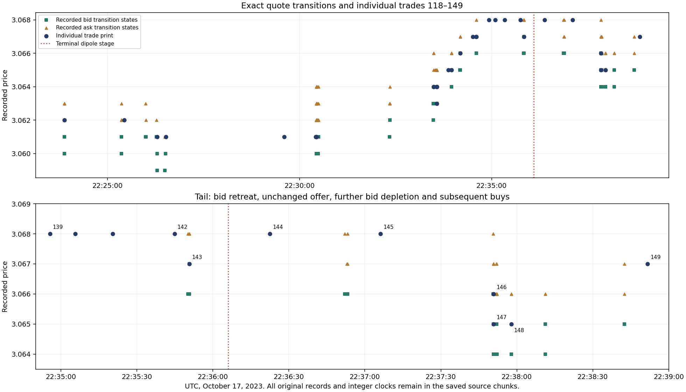
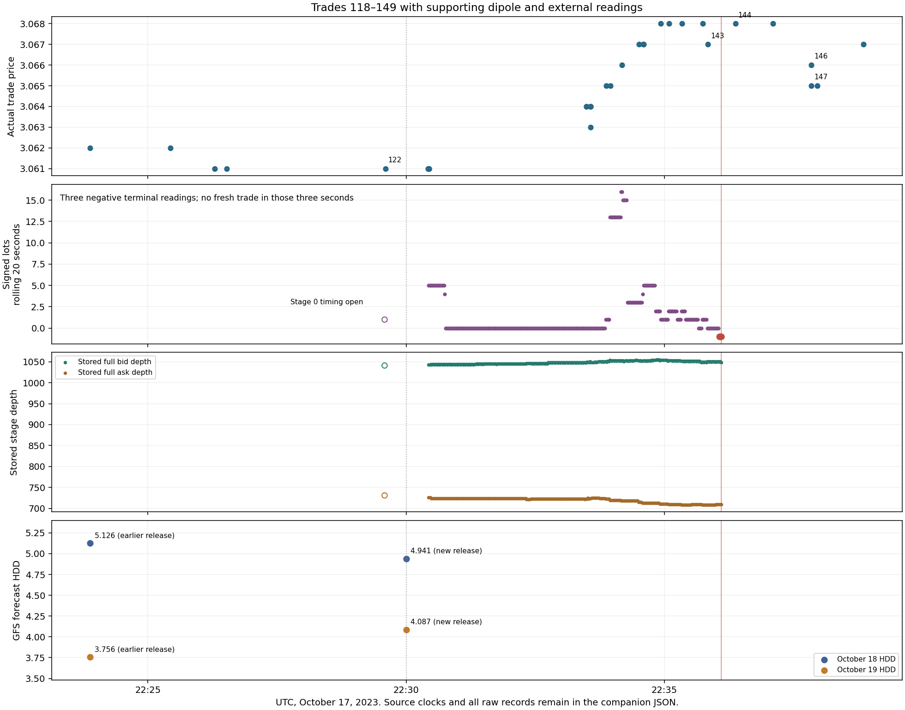

# Trade lifecycle evidence and first combined interpretation

## Broader whole-day explanations: fresh flow, rolling state and quote response

Read [day-wide-mechanisms-v1/README.md](day-wide-mechanisms-v1/README.md), its [receipt](day-wide-mechanisms-v1/analysis-receipt.json) and [verification](day-wide-mechanisms-v1/verification.json). This continuation retains all 30,739 original trades and combines saved quote sources into 2,715 exact prior/close comparisons. It finds 343 changed prints with unchanged group quotes, 22 opposed print/midpoint changes, 2,605 saved seconds with nonzero rolling flow but no new tape trade, and 112 with opposing fresh net/rolling signs. Eight continuous unchanged-group-quote runs contain both rising/falling prints; all eight lie within the saved 375/391 window, not independent full-day replications. All 48 external series and the complete original history remain linked; shared traded-curve fields are not independent news. Original states, contradictions and unmatched trades remain explicit. No AWS operation or refit occurred; semantic coverage stays **NOT_PASSED**, MLP repeatability **UNRESOLVED**.

## Completed-run knowledge and the broader SQLite comparison

The run-session screenshots identify the completed expanded family-model run at **682b69b3**. Its newly pushed [deep-market inventory](../deep-market-data-inventory-20261023.md) is now incorporated alongside an explicit [completed-run evidence index and SQLite findings](completed-run-connections-v1/README.md). The exact [original master list](../completed-run-source-list.json) still controls scope. The new index connects all 30,739 unchanged trades to the original 749 model-context timeline, all earlier/later contexts, saved order evidence and Frankie knowledge, without inventing per-trade predictions or claiming every retained claim has been scientifically consumed.

The saved SQLite comparison finds **819 of 832** absorption records linked to tape have a source traded-quantity counter different from the individual tape total. The adapter's T-plus-F counter definition is a broad explanation for that comparison; it does not fill missing quantities. Saved lineage matches only four of 7,939 queried order identities, so trade 119/134 quantity gaps remain unresolved. Read the [receipt](completed-run-connections-v1/sqlite-query-receipt.json), [verification](completed-run-connections-v1/verification.json) and broader mechanism questions in the new README before continuing serial case reviews. The screenshots establish this completed run's identity; attribution to a separate Janus + HippoRAG execution remains unverified. Semantic coverage stays **NOT_PASSED** and MLP reproducibility **UNRESOLVED**. No AWS operation or refit occurred.

## October 23 continuation: source roles and whole-day chronology

The [saved role reconciliation](quote-order-gapfill-v1/role-reconciliation-v1/README.md) adds exact resting-order identities for the ambiguous T/F cases and explains the literal producer continuity flag. Resting ask sides are resolved for trades 126/133; their reported aggressors remain N. Trades 123/128 retain different execution/resting prices for same-ID T/F records. Quantity allocation for trades 119/134 and channel completeness remain open. This adds evidence beside the earlier checked findings without overwriting them.

The [whole-day chronology](chronological-lifecycle-v1/README.md) annotates every individual trade through all 9,109 equal-price stretches and 5,120 overlapping print-step legs, retains the complete earlier/later tape and all original evidence-layer links, and explicitly marks unfinished mechanisms. This extends observed lifecycle coverage across the entire population; it does not make print turns into quote reversals or pass semantic coverage. All 30,739 original trades remain unchanged, including 16,040 without a saved overlapping dipole. Semantic coverage stays **NOT_PASSED** and MLP reproducibility stays **UNRESOLVED**.

The same continuation now separately retains all 6,634 original selected bid/ask measurement records and compares them to every trade, leaving missing coverage explicit. Among 1,447 trades with usable paired prior/close quotes, 149 print changes accompany unchanged quotes and 13 oppose the group midpoint change. They span 146 and 11 emission groups respectively; shared groups are not independent observations. These are source-limited descriptive comparisons, not inferred order mechanisms or a predictive rule. Read the individual examples and exact clocks in the chronology README.

All **30,739 recorded market trades** remain the primary population. No trade is dropped, no trade prices are averaged, no model predictions are voted or blended, and no nested source payload is replaced by a scalar summary. Families and dipoles supply supporting context. This checkpoint adds inspectable evidence and bounded interpretation; it does not claim a finished explanation of every trade.

## Latest checkpoint: exact quote and order gaps filled

Read [trade-lifecycle-handoff-20261023.md](trade-lifecycle-handoff-20261023.md) for continuation. The bounded source read now retains **1,667 consecutive groups**, with original full native books/FIFO, packed ROOT frames, rich second-set rows and 12,662 lifecycle records: **17,663 original records** in total. Every transported row digest and all 32 exact trade T actions, pre-trade books and after-trade books passed verification. All 30,739 day trades retain their original fields in the supplementary links. Full nested source bytes are saved in `quote-order-gapfill-v1/`; no flattened replacement was made.

The two tail quote/order gaps are closed. [Each trade's exact analysis](quote-order-gapfill-v1/each-trade-exact-quote-order-analysis.json), [all 81 observed quote transitions](quote-order-gapfill-v1/every-observed-quote-transition.json) and [checked lifecycle findings](quote-order-gapfill-v1/checked-lifecycle-findings.json) now show:

| Trade(s) | Recorded mechanism | Lifecycle implication |
|---|---|---|
| 127 | The one displayed unit at ask 3.064 fills; ask becomes 3.066. | This event advances the quote through depletion of a thin local level. Full-book totals alone do not describe that local fragility. |
| 139–142, 144–145 | Buys fill standing ask orders at 3.068. Order `788699906633` is worked down across trades 139–141; `788699906668` fills at 142/144. Further orders remain behind them. | Buying persists while the offer stops advancing. Recorded queue continuity explains the ceiling without inventing hidden liquidity. |
| 143 | The sole one-unit bid at 3.067, order `788699917734`, has an explicit F and same-ID C cleanup. Bid falls 3.067 → 3.066; midpoint falls 3.0675 → 3.067. | A genuine quote retreat is already observable before the dipole's opposed terminal readings. The C is fill cleanup, not a fresh maker withdrawal. |
| 144 | The front ask order at 3.068 fills, while bid/ask remain 3.066 / 3.068. | The higher print buys an unchanged offer. It establishes neither a higher quote nor a bullish reversal. |
| 146–147 | Trade 146 fills the three recorded one-unit orders at bid 3.066; bid becomes 3.065. Trade 147 fills the single bid at 3.065; bid becomes 3.064. | These are further execution-supported bid retreats. They are more than tape alternation or a snapshot-based cancellation story. |
| 148–149 | Subsequent buys include removing the one-unit ask at 3.065 in trade 148, lifting ask to 3.066; trade 149 buys 3.067 without changing its quote. | The recovery remains beside the pullback; no tail is discarded to fit a single directional narrative. |

Four explicit new ask additions at 3.068 are retained, IDs `788699917763`, `788699917827`, `788699917842`, `788699917850`. Size-reducing M records following fills are also retained and are **not** counted as replenishment additions. Recorded FIFO is reconstructed FIFO; the sources do not expose native exchange priority IDs.

The bid retreat in trade 143 is known by **`1697582150669677102`**, cursor **5660**. The first opposed stage at `1697582164000000000` is **13,330,322,898 ns later**; the terminal reversal stage at `1697582166000000000` is **15,330,322,898 ns later**. The completed path row is known by `1697582167857645502`, cursor 5689. This dipole turn confirms opposing rolling flow after the price/queue deterioration in this episode; it is not its prebirth warning. Later evidence remains fully allowed in retrospective explanation.

Unfavorable or ambiguous records remain explicit. Trade 119 reports T size 1 without a same-price F in its completed group; trade 134 reports T size 12 with opposite-side F quantity 2. Trade 123 carries both same-side and opposite-side F records; its opposite-side F quantity matches its one-unit T, while summing both F sides would double-count that quantity. Trades 126/133 carry N-side records, and trade 128 has a same-side F without an opposite-side F in the group; side/role interpretation remains unresolved. Do not infer iceberg activity, unseen fills or a trade direction to erase these differences. Empty `integrity_delta` and `sequence_contiguous=False` are both preserved.

The source read took **45.413 seconds**, followed by transfer and verification. One existing AWS box was used; **all four boxes were verified stopped at October 23, 2026, 1:25:08 a.m. Eastern**. No model was refitted. Temporary transfer copies were removed; the new source records are committed in Git. Original archives, EBS, snapshot and source ledgers remain intact. Semantic coverage stays **NOT_PASSED**, and MLP reproducibility remains unresolved. Existing exhaustion work can supply a later annotation; the current evidence describes weakening upward price response and subsequent bid depletion without declaring a validated exhaustion signal.

## What the dipole overlay actually adds

Dipole retains directional flow, its persistence/opposition, full-book depth/order/level counts at stored stages, price coupling and orientation relative to the preceding candidate. These describe a flow episode around the trades. They do not independently establish a price turn, prebirth prediction, exhaustion, an execution, or survival of a particular order. Rolling flow and dipole readings share inputs; their agreement is not independent confirmation. SAME/FLIP orientation relative to another candidate is also distinct from the terminal REVERSAL phase and from a price reversal.

The first combined example is the original trade sequence **118–149** (zero-based source ordinals), including trades **122–143** overlapping `dip-19648-1697581775`. It is an exploratory example from this conversation, not a signal selected and validated out of sample. All original prints, the full nested dipole, compact second-set views, source references and surrounding lifecycle records are in [trade-dipole-overlay-example.json](trade-dipole-overlay-example.json).

| Added evidence | Observable finding | Gap it fills; remaining limit |
|---|---|---|
| Individual tape prints | The overlapping prints run from 3.061 to 3.067, reaching 3.068 in between. | The flow path accompanied a rise with a one-tick giveback; the phase label alone does not describe that price path. |
| Producer's rolling-flow definition and tape clocks | The three terminal stages at `1697582164000000000`, `1697582165000000000`, `1697582166000000000` each store signed flow −1. **No new trade was recorded during those three seconds.** The signed lots are a rolling 20-second window. | Repeated opposing windows are not three fresh selling bursts. They cannot establish acceleration of selling or three independent confirmations. |
| Stored stage price and full depth | Those same three stages all store price `3067000000`; bid depth is 1050, 1051, 1049 and ask depth 710 at each stage. | Flow opposition occurred without a stored price fall during those readings. Net depth changes do not identify execution, cancellation or absorption. Stored stage books may be carried from the latest source update. |
| Exact subsequent prints | Trade 143 is 3.067, size 1, event `1697582150669372401`, receive `1697582150669638037`, known-by `1697582150669677102`, input/close `5657/5660`. Trade 144 is 3.068, size 1, event `1697582182540204471`, receive `1697582182540971619`, known-by `1697582182540994234`, input/close `5711/5713`. | Exact ROOT/native records are now saved: trade 143 retreats the bid, while trade 144 buys an unchanged 3.068 offer. Read the latest checkpoint above. |
| Explicit replenishment action | At known-by `1697582171050270017`, cursor `5695`, original `A` adds one unit at bid `3066000000`, order ID `788699917772`, classified `NEW_ID_ADD`. | A displayed addition is directly supported. It is not inferred from snapshot differences, and does not establish iceberg refresh or the cause of the next higher print. |
| Replenishment outcome definitions | A nearby `RESTORED` episode reports arrival ratio 43 for one removed unit. The source explicitly credits arrivals to every pending episode in the price neighborhood. | This is arrival density relative to removed quantity, not proof that the original order returned or independent confirmations from shared attributions. |
| Full subsequent tail | Trades 144/145 print 3.068; trades 146/147 later print 3.066/3.065. The 60-second last-print endpoint is 43.459005766 seconds old. | Neither the first higher tail print nor a stale endpoint can settle the full lifecycle. The later pullback stays in the record. |
| Second-set values and states | All 19 compact numbers, source float64 hex, float32 values and state codes are attached for each trade at four original source views. | They provide far-book identity/priority/replenishment and step context where PRESENT. Far-book survival does not prove touch-order survival. MISSING placeholders are not measured zero. Definitions still govern interpretation. |

The path's candidate event second is `1697581775`, available second `1697581825` (50 seconds later). Its completed source row is known by `1697582167857645502`, cursor `5689`. Stage-zero book timing remains an open audit flag. These clocks describe sequencing and original measurement meaning; **all later evidence remains allowed** in current retrospective explanation.

## Other newly checked trade mechanics

### External context now joined to every trade

`every-trade-original-external-links.jsonl.gz` attaches **all 48 original series covering all 13 run bindings** to every one of the 30,739 trades. Each series points into the unchanged nested `../external-classroom-audit-v1/original_series_known_values.json` (211,055 original known rows). Receive-time and group-close views retain last-published and first-later pointers; the whole history remains available. Publication clocks organize views without excluding later evidence, and no missing/invalid state is replaced with an older valid value.

For the same trade sequence, [trade-dipole-external-overlay.json](trade-dipole-external-overlay.json) supplies original source rows and contradictory context:

- GFS at declared publication `1697581800000000000`, between trades 122 and 123, changes October 18 HDD **5.126 → 4.941** while October 19 HDD changes **3.756 → 4.087**. The target dates match within each comparison. These opposite changes remain separate; their publication during the sequence does not establish which, if either, caused a trade move.
- Twenty-five constituent series declare updates somewhere in trades 118–149; **none** declares a fresh publication during the three terminal dipole seconds. This narrows a fresh-release explanation at that instant while preserving background and later information.
- Several city-temperature rows are explicitly INVALID. ATL's original `tmpf` is the string `M`, not a measured zero or an actual new temperature observation.
- At trade 143, several traded-curve fields share original source ordinal **16023** and publication/receive `1697582150669638037`. Multiple fields of that same underlying row cannot serve as independent confirmation of the trade.

The declared publication timestamps are not proof of live delivery. Original full rows, states, reasons and later observations remain accessible. No new AWS read or model fit was needed for this addition. See `external-overlay-receipt.json` and `external-overlay-verification.json`.

### Execution and removal identities

Trades 32 and 33 share one native emission, cursor 1141: two units at 3.058 and one at 3.059. The original queue records show three filled ask orders (IDs `788699907318`, `788699907316`, `788699906908`). Their `C` cleanup messages must not be counted as three new maker cancellations. In another direct example at cursor 374919, one removed unit belongs to a FILLED order and six to a CANCELLED order. Treating all seven as makers pulling would change the explanation incorrectly. Original records are retained in [new-trade-order-evidence.json](new-trade-order-evidence.json).

Across the preserved removal records, 5,680 link to FILLED terminal orders, 2,213 to CANCELLED terminal orders, and 17 lack that exact same-emission terminal-order match. These are coverage/mechanics checks, not a pooled trade signal. All 7,910 original removals remain individually inspectable.

The saved absorption calculator also needs its source units: its reference adapter sums FILL and TRADE action quantities; `depth_at_open` is traded-plus-withdrawn action quantity, and `surviving_depth` is added action quantity. These are not automatically unique tape volume, full standing depth, or proven FIFO survival. MIXED-side response sign is not an unqualified market direction. [per-event-unit-reconciliation.jsonl.gz](per-event-unit-reconciliation.jsonl.gz) retains each original event and its individual prints. Reference code is saved under `producer-source/`; byte identity to every runtime producer remains a separate provenance limitation.

## Day-wide evidence retained

| Artifact | Scope |
|---|---|
| `every-trade-evidence-bundle.jsonl.gz` | All 30,739 original trades, unchanged original fields, exact integer clocks/cursors, chronological neighbors and nested-source references. |
| `original-native-trade-groups.jsonl.gz` | 29,797 native emission groups, each preserving its individual original prints. |
| `source-*.jsonl.gz` | All 388,640 nested records from the exact saved lifecycle SQLite member, including 308,611 lineage records. |
| `supporting-path-phase-annotations.jsonl.gz` | Separate reconstructed annotations for 862 stored dipole paths and 54,042 stages. Full originals remain in `source-episode.jsonl.gz`; 16,040 trades with no overlap are retained. |
| `original-root-native-measurement-rows.jsonl.gz` | 1,872,499 unchanged long-form measurement rows at trade emission/prior group ordinals in the existing selected-context export; references for every trade are in `every-trade-root-record-links.jsonl.gz`. |
| `second-set-source/` | Full original bytes of four compact source members (771,787 rows), preserved in gzip chunks below GitHub's per-file size limit. |
| `every-trade-original-second-set.jsonl.gz` | All trades matched exactly to input and emission clocks; full named 19-number compact views with states at trade input, previous input, prior completed group and emission close. |
| `all-99-source-role-coverage.csv`, `all-13-input-bindings.json`, `all-510-frankie-knowledge-claims.json` | Exact run roles/bindings and saved claims remain in scope. An inventory or claim is not proof its semantics have all been consumed or established. |
| `every-trade-original-external-links.jsonl.gz` | All 48 constituent external series at every trade, linked into the complete unchanged original nested history; all later rows retained. |
| `every-trade-observed-lifecycle-windows.csv.gz` | Supplementary per-trade navigation at 1/5/20/60/120/300/600 seconds, including endpoint ages and edge censoring. Never a replacement for the individual path or a strategy return. |

Original model forecasts stay at their original contexts in `../final-model-analysis-20261023/source/`. No prediction has been invented for an unmatched trade. Complementary model disagreements remain available without ranking, voting or averaging.

## What was missing, and what remains

The six-hour run already ingested and aligned substantial evidence by instrument, timestamp and cursor. This continuation is filling **local evidence availability and interpretation gaps**, not discovering that timestamps were absent or declaring that the completed run failed. Its 2,097 fits addressed family occurrence and signed/absolute quote changes at selected contexts. They were not finished trade-by-trade lifecycle explanations.

The targeted local phase took 55.831 seconds. A subsequent AWS-plugin presigned, fixed-range read retrieved only 44,748,800 compressed bytes of one named archive in 27.129 seconds, verifying the four newly transported member identities against the original receipt. No whole archive/database rehash, EC2 start, fit or new resource was needed. Timing describes these phases, not all review work. [source-provenance.json](source-provenance.json) and the separate receipts retain the distinction.

Still open:

- **Continuous evidence at every trade:** the original selected projection has exact-emission ROOT measurements for 1,543 trades and prior-group measurements for 2,070. The new bounded source read adds complete consecutive records for groups 3046–4712 and exact pre/after contexts for trades 118–149. This is not yet a continuous full-day local export. Missing links retain the trade and mean neither zero nor no activity. A specific needed order/quote gap should lead to a bounded source read, not a broad rerun.
- **Full second-set richness:** the day-wide 19-number compact subset is not the entire rich second-set payload. The new bounded read now retains all fields in 1,667 original rich second-set rows for this episode. All raw trade-input rows lack PRESENT compact components; 28,402 emission-close views have at least one PRESENT component. Exact clocks match. Preserve states without inventing a reason absent from the compact source.
- **Exhaustion:** use the existing exhaustion work and its source definitions. Append its later results by instrument, exact clocks/cursors and order/path identity. Do not duplicate that workflow or hold all other trade analysis until it finishes. Distinguish weakened new aggressor flow, loss of price response, opposing flow, a real price flip, and an observation boundary.
- **Source geometry and units:** 12,528 ladder records say FULL_BOOK_TRANSITION and two say GROUP_LOCAL_DELTA, but older rounded ladder price geometry must not substitute for correctly scaled ROOT quotes. Scope alone does not certify units. New quantity/order reconciliations are explicit above.
- **Scientific gates:** semantic coverage remains **NOT_PASSED**. The unresolved MLP occurrence repeatability evidence remains: the 120-second fold-4 repeat differs by max 0.4313412606716156; log losses 1.5684192762348583 versus 2.915890359438005. Invalid negative magnitude predictions, poor interval calibration and one-day validation also remain. No new fit or selected success example resolves those limits.

The next combined analyses should keep trades as the entry point and ask which additional original layer distinguishes each plausible mechanism, including contrary, flat, stale and unresolved outcomes. Dipole is one supporting description, not the population selector or the answer.

## Reproduction of this checkpoint

The ordered helper scripts are in `tasks/family-research-20261022/`: `targeted_trade_lifecycle_pass.py`, `read_bounded_second_set.py`, `finalize_trade_evidence.py`, `attach_trade_root_and_order_evidence.py`, `audit_trade_dipole_overlay.py`, `attach_trade_external_evidence.py`. The bounded-read helper accepts a temporary URL through stdin and never saves it; **no network repeat is required to use this checkpoint**, because original compact chunks are already saved. The finalizer removes only redundant scalar intermediates made by this pass and keeps nested originals. `checkpoint-verification.json` and `external-overlay-verification.json` record preservation checks. `plot_trade_overlay.py` draws the individual observed points in `trade-dipole-overlay.png`; it does not interpolate a continuous market path.

The new source helpers are `export_bounded_quote_order_sources.py` and `receive_quote_order_sources.py`. Existing output is already local and in Git: do not rerun their transport step. `analyze_quote_order_gapfill.py` verifies the new original chunks and attaches every day trade, and `finalize_quote_order_interpretation.py` separately clarifies fill-side roles without discarding any original F/C record. Their saved verification and analysis outputs are ready to use; no repeated source hashing is required.
