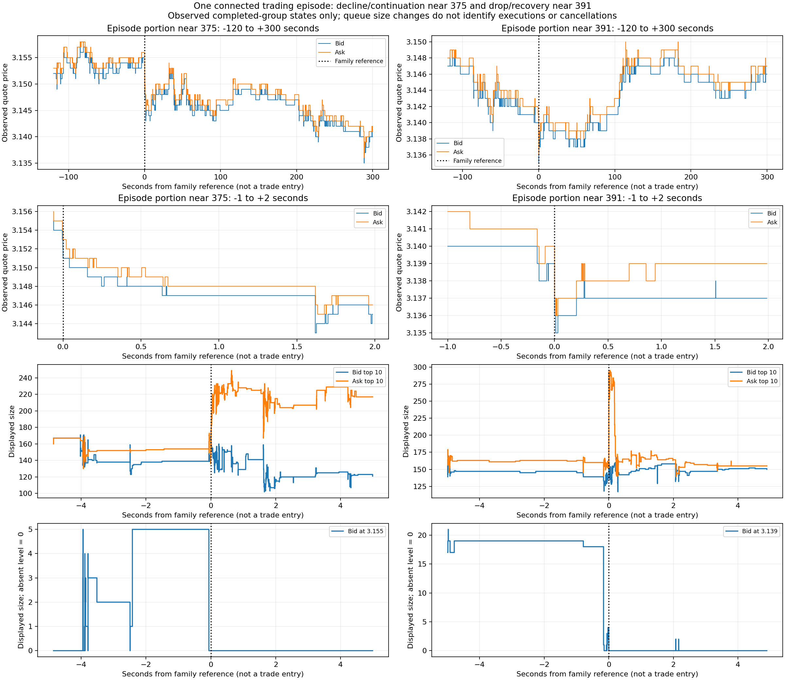

# Supporting reconstruction near references 375 and 391

This is a supporting quote/queue reconstruction within one connected trading episode. It is not the day's trade inventory or a completed review of all run inputs. The primary trade record is `../price-curve-timestamps.csv`: 30,739 recorded transactions, independently of the 749 family records. All available evidence, including later knowledge, belongs in retrospective interpretation. The saved run source list, not a hand-built shortlist, defines the evidence scope.

The main checked distinction is decline/continuation near 375 versus a sharp drop and faster recovery near 391. At 391 the group at the family reference moves the midpoint from 3.1395 to 3.1365; the first-five-second low is 3.1355 at +12,171,856 ns. The midpoint recovers half that decline at +204,735,373 ns and returns to 3.1395 at +2,072,467,372 ns. At 375 the first-five-second low is 3.1445 at +1,620,254,911 ns, with half recovery at +14,499,905,927 ns and baseline recovery at +32,188,630,940 ns. These are descriptive first passages, not strategy entries or exits; first recovery is not an established terminal end. The 300-second minimum after 375 is the same observed low near 391, directly showing their overlap.

At 375, ask size at fixed price 3.156 rises from 8 to 13 at known-by 1697634552020659344, then to 17 at 1697634552020802137; bid 3.155 remains size 5 across two orders. The first lower-midpoint update is known at 1697634552021257311. These offer-size distinctions precede that update by 597,967 and 455,174 ns. The tape separately records a five-unit trade at 3.155, trade ordinal 11085, trade cursor 303547, available at that lower quote's group-close cursor 303552. A recorded execution does not reconstruct every intervening add/cancel or individual FIFO identity.

At 391, bid 3.139 disappears and reappears before the reference, growing from size 1 to 4 across four orders before another sharp drop. Refresh therefore did not suffice to establish exhaustion. After the drop, bid 3.136 reappears with size 6 at known-by 1697634840909745564, then reaches size 23 across nine orders at 1697634841068145046. A concentrated ask at 3.137 has size 150 in one order at the reference, declines to 47 across two orders at the latter checkpoint, and is absent at 1697634841082639442. These are observed displayed states. Their net changes alone do not split fills/cancellations or prove absorption or order survival.

The recorded one-second buy/sell aggressor totals at the strict pre-reference snapshots are 0/24 near 375 and 6/26 near 391; their reference-group totals are 0/32 and 6/76. Rolling-window differences are not automatically interval flow. The saved far-cohort fill-attributed removal share also goes against a casual whole-market absorption story: `second_group.far_absorption_share_64` is 0.3387096774193548 near 375 versus 0.019230769230769232 near 391. Those are source-defined selected-cohort measurements, not an independently reconstructed bid-wide absorption mechanism. Raw second-set values, states and reasons are retained in `episode-group_measurements.csv.gz` and `episode-features.csv.gz`.

`availability-evidence-ledger.csv` retains exact event/receive/known-by clocks, cursors, comparison times and competing interpretations. Its eligibility columns are supplementary historical timing diagnostics, not exclusion rules for the current retrospective research. `checkpoint-full-ladders.csv.gz` contains checked full ladders; `nearby-queues-and-fixed-prices.csv.gz` retains the nearby depth and selected fixed absolute prices at every selected group; `fixed-price-queue-timeline.csv.gz` explicitly distinguishes absent levels. Missing boundary states are not interpolated.

Original forecasts for all recorded case targets/horizons/models are unchanged in `original-all-model-forecasts.csv.gz`; the original readable tables are in `../instance-market-review-20261023/cases/0375.md` and `0391.md`. Their disagreements are preserved. They are forecasts at the original family-selected contexts, not newly generated forecasts for every trade. Some absolute-change predictions are invalid negatives; quantile coverage is poor. No architecture is selected or averaged into a trade signal.

Semantic coverage stays **NOT_PASSED**. Residual-MLP occurrence 120 s/fold 4 repeatability remains unresolved: maximum prediction difference 0.4313412606716156, original logloss 1.5684192762348583 versus repeat 2.915890359438005; the original completed attempt remains canonical. The local continuous book window does not reach 391 +600 seconds, so the later negative saved endpoint does not supply a fabricated intervening path.

Pending: join the actual trade sequence as the primary sequence, then interpret the completed run's full source list around each trade/lifecycle. This supporting extraction does not certify complete day-wide depth/FIFO/Bedrock/knowledge consumption. No new fits, AWS actions or live execution occurred.
