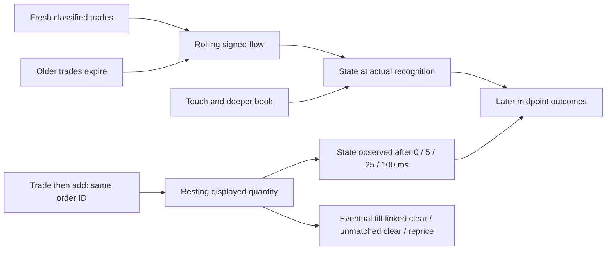
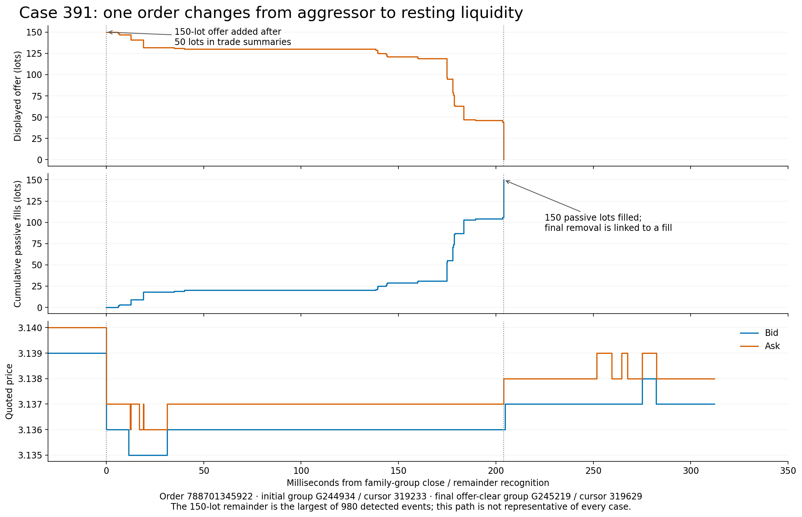
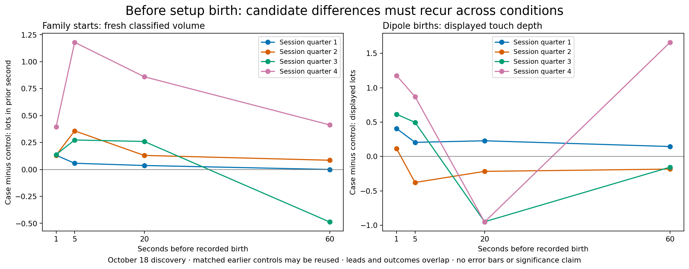
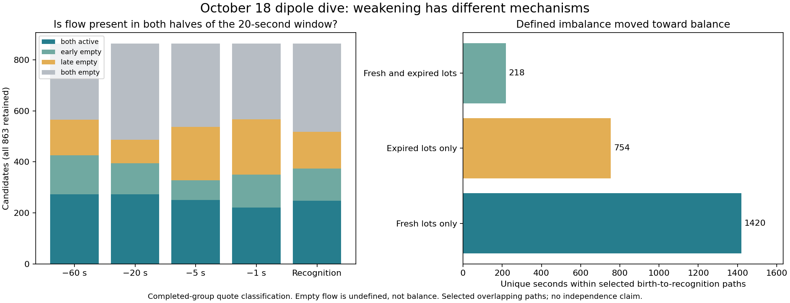
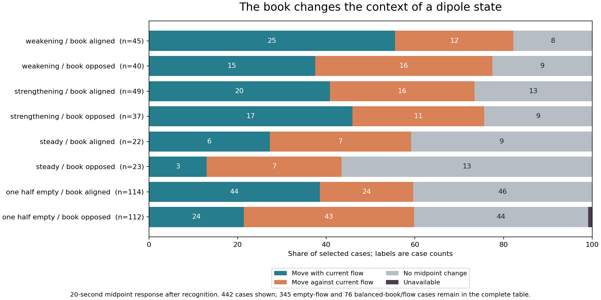
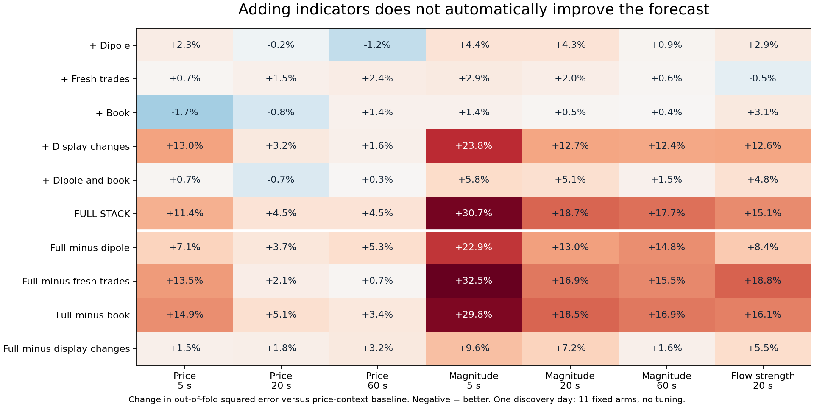

# Codex October NG flow and book discovery

Independent Codex research notes, November 8, 2026. The user requested separate
Markdown findings for the independent reviewers, to merge at the end. This file
therefore carries this review's findings and interim table index; the shared
October discovery log is unchanged. Claude should retain its own interpretation.

Source evidence is pinned to `b5f28bd57de5ed4ff889335edb9a33216b67eb6a`, including
the original 749 SQLite family starts, the original 50 matches, the October 18
group export and the 863 reconstructed dipoles. The updated research handoff is
`5724f4096248dd8080aa381a34855097c685dc1c`. Raw message extracts use
`1d15dc6f1b5bbb1fabb6389d18e8bedba2b77202`. These are the common inputs available
to both reviewers. All four dates remain discovery; October 2 and 17 are partial.

## What the current comparison says

**NG-FLOW-BOOK-v1.** Recent signed flow, the local quote, and total displayed depth
describe different things. Total depth was bid-heavy at all 749 saved family
starts. It cannot distinguish these cases by sign, even though its magnitude
varies. Local touch depth can oppose that whole-book sign. The original 50-case
stack has both subsequent directions and flats. Its five-minute downward
majority largely disappears as a mean difference against the selected activity
controls. The four-arm model probe does not establish a general benefit from
stacking flow with this book representation.

**NG-DIPOLE-POST-RECOGNITION-v1.** The detector tracks the shape of rolling signed
trade imbalance, whose changes can reflect new prints or old prints aging out.
Persistence or reversal of that ratio is different from persistence or reversal
of price. Most one-second midpoint outcomes after actual recognition are flat.
Birth-to-recognition descriptions should not be presented as future forecasts.

**NG-391-SWEEP-AND-REST-v1.** The initial sell sweep and the subsequent large offer
in case 391 share an order ID. That offer then receives 150 lots of passive fills
and is removed before the quote recovers. The observed switch from aggressive
execution to resting liquidity, then opposite-side execution against it, links
two previously separate parts of this case. It does not identify trader intent,
establish a trade signal, or show how often this specific mechanism occurs in
the other 48 original cases.

## Cohort, controls and contrary observations

The opportunity is a first-observed structural family, not the birth of its
orders, the first onset of the pressure condition, or an unconditional market
opportunity. Predictors use the retained strict-pre family projection and the
last completed group satisfying both the receive cutoff and cursor cap. Outcomes
use the last observed valid midpoint at or before the declared horizon. Exact
source groups, cursors, nanosecond clocks, quote ages, raw changes, ticks and
percentage changes are retained. Halt/reset crossings and session-end censoring
stay explicit. An old but unchanged quote is retained with its age, not treated
as a fresh transaction.

| Original 50-case stack: horizon | Down | Flat | Up | Overlapping-window clusters |
| --- | ---: | ---: | ---: | ---: |
| 1 second | 23 | 6 | 21 | 48 |
| 5 seconds | 23 | 3 | 24 | 46 |
| 20 seconds | 23 | 10 | 17 | 43 |
| 60 seconds | 29 | 5 | 16 | 35 |
| 300 seconds | 33 | 1 | 16 | 23 |

The screen reproduces the exact 50 original instance IDs. Among all 749 starts,
437 have usable one-, five- and 60-second signed ratios; 312 lack at least one
ratio, commonly because the denominator has no classified volume. Missing flow
is not balanced flow. The complete input cohort for all four arms is 437.
There are 749 available outcomes at one and five seconds, 748 at 20 and 60,
and 742 at 300 seconds before common-input filtering.

**Unsupported inverse and a useful partial contrast.** Full-book imbalance
ranges from +0.014737 to +0.416769 across all 749 starts. There are zero exact
inverse-stack cases because the required ask-heavy full book never occurs.
There are 45 cases with inverse *flow* alone: sell-heavy 60 seconds followed by
buy-heavy five and one seconds. Preserve these as a separate comparison, not
as fabricated support for the full inverse stack.

Local touch direction changes the interpretation of the same aggregate stack.
Of the original 50, 21 have touch imbalance aligned with recent selling, 24
oppose it, and 5 have equal touch size. At one second, aligned cases have
12 moves with selling, 6 against and 3 flat; opposed cases have 9 with,
13 against and 2 flat. The inverse-flow cohort does not reproduce that contrast:
its 21 aligned cases have 12 moves with buying, 4 against and 5 flat, versus
11 with, 5 against and 5 flat among 21 opposed cases. These small, overlapping,
selected cohorts challenge a universal alignment rule.

For each original match, the descriptive control is another family start in the
same UTC hour and spread, nearest in log(1 + 60-second classified lots), then in
clock distance. This uses no later outcome. Matching uses replacement: 50 pairs
reuse 35 controls. The median absolute log-activity difference is 0.0653 and the
maximum is 0.7538; there is no caliper, so some matches are loose. Mean case-minus-
control midpoint changes are -0.00015 at one second, -0.00103 at 60 seconds, and
-0.00006 at 300 seconds. The original five-minute mean is -0.00059 versus
-0.00053 for its controls. Overlap and imperfect balance prevent a causal or
independent-significance interpretation.

[Opportunities](flow-book-discovery-v1/opportunities.csv.gz) ·
[All outcomes](flow-book-discovery-v1/outcomes.csv.gz) ·
[Cohort distributions](flow-book-discovery-v1/cohort-outcomes.csv) ·
[Setup cross-tabs, including inverse flow](flow-book-discovery-v1/setup-crosstabs.csv) ·
[Matched controls](flow-book-discovery-v1/activity-controls.csv) ·
[Paired outcomes](flow-book-discovery-v1/activity-control-outcomes.csv)

## Four comparable arms

The baseline includes spread, unsigned classified activity at one and 60 seconds,
and prior midpoint changes over one and five seconds. The flow arm adds the three
signed ratios. The book arm adds touch imbalance and size, changes in touch
imbalance, same-price display changes with explicit price-movement flags, and
near/full-depth imbalance. Both includes both blocks, additively. Display changes
are not relabeled as fills or cancellations. This is a limited representation of
book behavior; it does not encode every queue or order mechanism.

Ridge uses fixed alpha 10, training-only scaling and intercept, three expanding
chronological splits starting at 40%, 60% and 80%, outcome-end purge and a
600-second embargo. All arms use the same rows and outcomes. There are 263 test
predictions per arm at each horizon through 60 seconds, and 260 at 300 seconds.
These are within-day discovery probes, not external validation or admitted
scoring models. The arm names mean baseline **plus** the named block.

| Target / horizon | Baseline MAE | Flow MAE | Book MAE | Both MAE |
| --- | ---: | ---: | ---: | ---: |
| Signed / 1 s | 0.001509 | 0.001505 | 0.001770 | 0.001714 |
| Signed / 20 s | 0.002450 | 0.002513 | 0.002796 | 0.002829 |
| Signed / 60 s | 0.003009 | 0.002997 | 0.003245 | 0.003219 |
| Signed / 300 s | 0.006206 | 0.006198 | 0.006710 | 0.006709 |
| Absolute / 1 s | 0.001151 | 0.001153 | 0.001268 | 0.001266 |
| Absolute / 20 s | 0.001930 | 0.001897 | 0.001933 | 0.001912 |
| Absolute / 60 s | 0.002061 | 0.002060 | 0.002001 | 0.001998 |
| Absolute / 300 s | 0.004279 | 0.004275 | 0.004426 | 0.004430 |

Table values pool individual test-row absolute errors, rather than giving unequal
fold sizes equal weight. All five horizons and each fold remain in the artifacts.
Book and both worsen pooled signed error at every tested horizon. Absolute-move
results differ by horizon and fold: both improves 60-second absolute error in
folds 1 and 3 but slightly worsens it in fold 2; at 20 seconds it worsens fold 1
and improves folds 2 and 3. This is contrary evidence to a uniformly helpful stack.
Negative predictions for the absolute target remain recorded, without clipping.

The first exploratory pass purged only overlapping labels. Its metrics,
predictions and splits are preserved under `initial-no-embargo/`. The reported
pass adds the standing protocol's 600-second embargo. This was a protocol
correction, not selection of an embargo to improve results. Both outcomes remain
available. No hyperparameter search was performed.

[Exact method and feature lists](flow-book-discovery-v1/method.json) ·
[Fold metrics](flow-book-discovery-v1/arm-metrics.csv) ·
[Every prediction](flow-book-discovery-v1/arm-predictions.csv.gz) ·
[Train/test membership and clocks](flow-book-discovery-v1/chronological-splits.csv) ·
[Initial pass](flow-book-discovery-v1/initial-no-embargo/arm-metrics.csv) ·
[Reproducible comparison code](flow_book_discovery.py)

## What cases 375 and 391 add to the broad comparison

The original full-depth condition is shared, but the local touch differs.
Case 375's strict-pre G233425 / cursor 303645 has bid size 7 and ask size 25:
touch imbalance -0.5625, aligned with recent selling. Case 391's G244933 /
cursor 319188 has bid size 4 and ask size 3: +0.142857, opposing recent selling.
Both subsequently fall. Case 391 therefore remains a counterexample to treating
a bid-heavy touch as protection from the next decline. The following later
events explain parts of the path, but were not all available at those decisions.

| Case and source coordinates | Observed mechanism and availability |
| --- | --- |
| 375, cursors 303542–303552 | Before the family anchor, new offers of 5 and 4 lots join at 3.156. A one-lot trade at 3.155 is followed by a five-lot trade, passive fills and linked removals of bid orders 788701294308 and 788701294279. G233368 closes with the lower bid. Offer growth preceded this quote change by fractions of a millisecond; this does not establish executable advance warning. |
| 375, cursors 303646–303656 | The family group includes an eight-lot trade summary at 3.152, six lots of identified passive fills and seven lots of bid removals. Keep those distinct totals; do not force trade summaries and visible passive messages into one conserved quantity. Completed-group recognition is 1697634552081390598 ns, after the raw actions. |
| 391, cursors 319189–319233 | Order 788701345922 appears in trade summaries for 4 lots at 3.139, 15 at 3.138 and 31 at 3.137, then in an add of 150 offer lots at 3.137. The same order ID links the sweep to the resting offer, consistent with an unexecuted remainder becoming displayed liquidity. The group closes at 1697634840878613141 ns with bid 3.136 and ask 3.137. These are family-group outcomes relative to the frozen prior completed quote. |
| 391, that order's later fills through cursor 319627 | The displayed offer receives 150 lots of identified passive fills. Its modifies reduce displayed quantity, and the final 44-lot fill is followed by a 44-lot removal. Another one-lot offer also fills and is removed. G245219 / cursor 319629 closes at 1697634841082639442 ns with the next ask exposed. This is 204.026301 ms after the family close. |

The last sequence resolves a previously open distinction: that offer's final
disappearance is fill-linked, rather than an unexplained withdrawal. It also
shows why a large displayed ask can be both an immediate obstacle to recovery
and liquidity against which recovery demand executes. Subsequent bid improvement
and later renewed declines remain separate steps. Both 375 and 391 eventually
recovered their strict-pre midpoint; their different five-minute endpoints do
not describe uninterrupted continuation versus reversal.

The initial 391 trade summaries total 50 lots; the retained passive fills within
that initial group total 40. The later 150-lot resting-order sequence is a
separate directly linked observation. Native order identity does not identify
the beneficial owner, the trader's total position, urgency or loss aversion.
The raw extracts cover one second before through five seconds after each family
anchor: 1,612 messages for 375 and 1,207 for 391. Mechanism frequency across all
50 remains unmeasured; the complete cohort outcomes above provide the broader
context without inventing the missing order-level prevalence.

[Original messages with order IDs and UTC-member record indices](flow-book-discovery-v1/case-original-messages.csv.gz) ·
[Raw source and exact extraction spans](flow-book-discovery-v1/original-message-source.json) ·
[Both cases' retained measurements](flow-book-discovery-v1/case-375-391-measurements.csv) ·
[Earlier continuous quote and queue evidence](../../artifacts/sqlite-triage/20261022/families/trading-episode-375-391/availability-evidence-ledger.csv)

## Dipoles after actual recognition

Outcomes here start at the actual recognition close, not the nominal availability
second or the birth second. Orientation is relative to birth polarity, including
when the rolling flow has already reversed. These are 863 selected recognitions;
unrecognized opportunities are outside this cohort.

| Flow state at recognition | Cases | Same as birth at +1 s | Flat at +1 s | Opposite at +1 s |
| --- | ---: | ---: | ---: | ---: |
| Still same direction | 275 | 29 | 211 | 35 |
| Reversed direction | 217 | 28 | 164 | 25 |
| Balanced, classified volume present | 26 | 3 | 17 | 6 |
| Undefined, no classified volume | 345 | 38 | 279 | 28 |

Together, 671/863 are flat at one second. This differs from the earlier
birth-to-recognition table, which describes movement already realized when the
candidate appears. At 300 seconds, the still-same cohort has 131 with birth,
126 against and 15 flat among 272 available outcomes; three are censored.
The reversed cohort has 93 with birth, 106 against and 17 flat among 216
available outcomes. Both directions remain substantial.

The broad distinction appears in the same pinned concrete cases:

- `dip-19648-1697581215`, recognition G2363 / cursor 3411: empty recent flow,
  flat midpoint at +1, +5 and +20 seconds. The +20 endpoint is G2533 /
  cursor 3612, receive 1697581282196212863 ns.
- `dip-19648-1697583021`, recognition G6230 / cursor 7726: the intervening ask
  sweep had already happened and aged out of the rolling window. The midpoint
  is flat at +1 second, then down 0.0005 at +5, +20 and +60. A mechanism that
  explains the earlier rise does not guarantee continuation after recognition.
- `dip-19648-1697625921`, recognition G112817 / cursor 141147: late flow is
  14 buy versus 39 sell lots while the birth-to-recognition midpoint had risen.
  It is flat over all sampled endpoints through +60 seconds, then up 0.0030 at
  +300, endpoint G114709 / cursor 143584, receive 1697626236183886050 ns.
- `dip-19648-1697607905`, recognition G42542 / cursor 51260: late flow is
  4 buy versus 25 sell lots. Post-recognition midpoint first rises 0.0005 at
  +1 second, falls 0.0005 at +5 through +60, and rises 0.0025 at +300.
  Endpoint signs alone conceal the changing path.

All exact recognition and endpoint coordinates, quote ages, percentage changes,
flow numerator/denominator operands and censoring are retained. Holding quotes
through quiet intervals can produce flat endpoints without a fresh price test.

[All recognition-to-outcome rows](flow-book-discovery-v1/dipole-after-recognition.csv.gz) ·
[Every state/horizon summary](flow-book-discovery-v1/dipole-after-recognition-summary.csv)

## The 99 planes, 13 inputs and cross-layer questions

The [99-role table](flow-book-discovery-v1/all-99-relationship-roles.csv) preserves
every registry entry. Market mechanisms, derived transforms, source clocks,
controls, runtime records and later outcomes have different research roles;
the registry is not 99 independent numerical predictors. The retained numeric
screen covers 135 local feature definitions and 89 selected external field/series
combinations, 224 total. It keeps all 14,784 attempted rank comparisons across
the whole cohort, original 50 and four chronological quarters, including
constant and insufficient-support results. It provides hypotheses rather than
significance claims or new semantic admission.

**NG-RELATION-SCOPE-v1.** One-second flow imbalance has pooled Spearman +0.3069
with the next one-second signed move on 437 defined observations. Each quarter
is positive (+0.4543, +0.3110, +0.1986, +0.2904). Yet the four-arm flow increment
is small and does not uniformly improve errors. Correlation and incremental
forecast value answer different questions when the baseline already contains
activity and recent price response.

Full-book imbalance has pooled +0.2370 rank correlation with 20-second absolute
move on 748 observations, but quarter correlations are -0.0064, +0.1429,
-0.1231 and +0.0875. The pooled association is not a stable within-quarter
relationship. Similarly, far-size retention has pooled -0.1381 correlation with
the next one-second signed move on 617 observations, but +0.0414 among the
43 original-stack cases with that field. Queue identity survival shows a related
change. These are plausible context interactions and shared-measurement effects,
not evidence that a far queue universally predicts the opposite direction.

The [13-point coverage table](flow-book-discovery-v1/all-13-point-coverage.csv)
keeps the original bindings and source dependencies. Points 1, 3 and 4 reuse one
NYMEX positioning source; 5 and 7 reuse the power source; 2 and 9 share weather
inputs. Positioning, storage and the carried storage surprise have no changing
source row across these 749 starts, so they cannot identify an intraday revision
effect here. Weather and curve series vary, but variation alone does not identify
which mechanism caused a short quote move. Point 6 is present in only 90 saved
contexts under its declared availability; do not backfill its later timestamp.

**NG-CURVE-CLOCK-COMMON-DRIVER-v1.** Of 62 external series rows per case, 18 have
different retained source ordinals between 375 and 391: one traded-curve series
and 17 station-weather series. Most carried positioning, storage, forecast and
power context is identical. The curve update for 375 is stamped
1697634552081117158 ns, the exact receive clock of the family group's trade at
cursor 303646. For 391 it is stamped 1697634840877425246 ns, the initial sweep's
receive clock at cursor 319189. Both are before the family close but after the
frozen previous completed book. This is a concrete shared-source/timing
alternative to interpreting the curve as an independent warning.

External operands preserve a `published_after_prequote` flag. Their exploratory
correlations use the saved declared publication cutoff, which can include these
partial-group trades; they are not inputs to the four-arm model. A subsequent
test must align all sources to one declared decision boundary and separate the
front leg's reused trade from genuinely independent maturity information.
Station changes need their underlying values and availability examined before
they can explain the divergence; a changed row ID is not a demand surprise.

[All field relationships](flow-book-discovery-v1/all-field-relationships.csv.gz) ·
[Local coverage and missing reasons](flow-book-discovery-v1/measurement-coverage.csv) ·
[External series coverage](flow-book-discovery-v1/external-series-coverage.csv) ·
[Exact external operands and source rows](flow-book-discovery-v1/external-operands.csv.gz) ·
[Both cases' original external records](flow-book-discovery-v1/case-375-391-external.csv.gz) ·
[Relationship method](flow-book-discovery-v1/relationship-method.json) ·
[Extraction and relationship code](flow_book_relationships.py)

## Psychology and competing explanations to carry forward

| Hypothesis | Observable support, contrary evidence and discriminating test |
| --- | --- |
| Urgent selling followed by relief or aggressive bargain buying | Case 391's sweep, resting remainder and later opposite-side fills fit the observable sequence. Ordinary algorithmic slicing, hedging or inventory adjustment can produce the same sequence. Compare sweep-to-rest episodes with similarly sized sweeps without a resting remainder, matched on prior flow, spread and depth. Participant positions or execution instructions would distinguish motives. |
| Defensive withdrawal amplifies selling | Case 375 has lower bids removed and new lower offers during the decline. Some removals are fill-linked; treating every C message as voluntary withdrawal would be wrong. Compare order-linked fill reductions with unmatched removals at fixed prices before the decision. |
| Absorption or resilient liquidity predicts a rebound | Case 391's large ask is completely executed and bids recover, but earlier bid reappearances preceded another drop. The original 50 also include contrary and flat outcomes in every touch-alignment stratum. Distinguish execution against a surviving order, new displayed orders, and price improvement; test what was known before the intended decision. |
| Shared information rather than distinct signals | Flow, midpoint, dipoles and the front curve leg reuse trades; several external inputs reuse the same source. Compare independently timed other-maturity changes and genuine publication revisions after controlling for local activity. The existing evidence does not supply trader intent or an independent surprise for these two cases. |

These are retained hypotheses, not psychological diagnoses or selected simulator
rules. Position/P&L data, complete participant identity and private stop or margin
instructions remain unavailable. Candidate recognition, historical path labels,
scoring admission and simulator execution remain separate. No paper ticket,
order, fill, fee-adjusted return or new noise judgment is asserted.

## Four-date table index: observed November 8 at 18:03 UTC

These are interim locations and compact captures, not completion claims.
Runtime revision from the execution handoff is
`6f9178bbb97721c7a71e94bb602ac256db348c87`. The existing heartbeat owns monitoring
and recovery. It was updated at the user's request to save each completed day's
unique data/code to Git, confirm publication, then shut down its idle original
pod independently. Shared network volume `qu5lhaqqbx` must remain intact.

| Date | Coverage and currently retained outputs | Job/standalone status at capture |
| --- | --- | --- |
| October 2 | Partial. 75,597 per-second flow and roll20 observations, seconds 1696204800–1696280396. Price summary reports 37,670 prints. ROOT references report 600,291 frames/structures; bulk spools remain remote. | `failed root-native exit=1` at 17:54:21 UTC; standalone held. These derived tables do not establish Native completion. [Index and exact paths](flow-book-discovery-v1/date-tables/20231002/table-index.json) |
| October 3 | Full-session tape scope. No small derived tables in the targeted locations at capture. | `root-native`; standalone waiting. [Index and exact paths](flow-book-discovery-v1/date-tables/20231003/table-index.json) |
| October 17 | Partial. 75,579 per-second flow and roll20 observations, seconds 1697500816–1697576394. Price summary reports 33,451 prints. | `root-native`; standalone waiting. [Index and exact paths](flow-book-discovery-v1/date-tables/20231017/table-index.json) |
| October 18 | Full session. 583,688 retained groups, 30,739 prints, historical ROOT/Native and reconstructed candidate evidence at the pinned revisions above. | Existing retained evidence reused for this research. [Shared historical index](october-discovery-log.md) |

Each remote control folder is `/opt/frankie-box/replay-control/YYYYMMDD`.
Actual ROOT data is under
`/opt/frankie-box/work/experiment-roots/ng-replay-YYYYMMDD/work/derived/`;
standalone output location is `/opt/frankie-box/work/standalone-inputs/YYYYMMDD/`.
The captures preserve small derived JSONs losslessly as gzip, including full
per-second arrays and spool references. `legacy_price.json` is the producer's
first/last summary, not a complete print export. Bulk frames/structures have not
been copied or claimed safely archived by this review. In particular, the October
2 frame reference reports 520,064,232,895 bytes; its remote pointer alone is not
sufficient grounds to shut down the pod. Save/shutdown remains the heartbeat's
separate task after necessary outputs and unique data are safe.

[Targeted table capture code](capture_discovery_table_index.py)

## Validation and remaining work

The new focused tests cover strict nanosecond/cursor boundaries, missing versus
balanced flow, inverse-stack classification, and exclusion of overlapping
training labels. The study also checks exact original-50 membership and each
retained family prequote's group/cursor against the standalone table. No prior
producer, teacher, receipt audit, old Search or AWS job was rerun.

Remaining work is explicit: reconstruct order-level prevalence beyond these two
cases; distinguish conditions at family starts from unselected market
opportunities; compare the other dates when their actual tables arrive; test
queue and independent external additions with aligned clocks; and merge the
independent reviewer notes while preserving disagreements. None of those pending
steps is replaced by the descriptive correlations or this limited ridge probe.

## Research atlas v2: mechanisms, observation time and replication

This increment expands the two-case investigation into a session inventory and
an explicit observation-time study. It is still discovery. The other three
dates have not completed their required box workflow or this research process.
The user clarified the sequence: finish ROOT/Native **and** the new standalone
touch/print pass on each original box, publish its unique outputs and necessary
code to Git, then shut it down. The reviewers do the research from those saved
outputs afterward; research does not require keeping an idle box running.

### A mechanism map with measured quantities

The arrows describe the analysis and accounting relationships, not established
causal effects. Eventual removal is kept on a separate branch because it is
future information at recognition. Participant intent, hidden reserve quantity,
execution quality and profitability are not observed by these measurements.

### Case 391 is part of a broader, highly uneven population

The new inventory scans 771,787 retained raw records against the pinned completed
groups. It finds **980** events with a nonzero order ID and matching wire side on
a trade summary followed by an add in the same group. There are 29,797 groups
with trade summaries. These counts describe the selected mechanism, not every
aggressive trade or every instance of absorption.

| Eventual resting disposition | Events |
| --- | ---: |
| Fill-linked final clear | 613 |
| Unmatched final clear | 324 |
| Reprice | 41 |
| Reset-censored | 1 |
| Session-end-censored | 1 |

Of these, 46 begin with trade summaries at multiple prices and 934 at one price.
There are 463 offer-side and 517 bid-side events. Median initial display is two
lots. Case 391's 150-lot remainder is the largest observed initial display, so its
striking path should not stand in for a typical event. Median observed duration
from initial completed-group recognition is 8.456486 ms across the inventory;
the censored cases remain labeled in the data and are excluded from the plotted
completed-duration distribution.

Order `788701345922` again yields 150 passive lots filled, zero unmatched display
reduction, and 204.026301 ms between initial and final completed-group recognition.
The terminal cancel record is linked to a passive fill; calling it a voluntary
withdrawal would misdescribe this path. Across the full inventory, ten events
retain unmatched fill accounting at a group boundary. That uncertainty is
explicit in `unmatched_fills_at_group_boundary`; it is not silently reconciled.
An unmatched final clear likewise does not prove discretionary cancellation.

Thirty-five of the original fifty families overlap at least one such event in
the descriptive window from one second before to five seconds after the family
anchor. That window includes future information and overlapping events. It is
an investigation link, not an independent confirmation or an available predictor.

[Event inventory](research-atlas-v2/aggression-to-rest-events.csv),
[raw action coordinates](research-atlas-v2/aggression-to-rest-actions.csv.gz),
[future outcomes](research-atlas-v2/aggression-to-rest-outcomes.csv.gz),
[family links](research-atlas-v2/family-to-resting-events.csv),
[method and source pins](research-atlas-v2/mechanism-method.json).

### Observing later changes which cases remain available

The timer study starts at actual initial completed-group recognition. Features
at each decision use only actions and quotes from completed groups available by
that decision. Outcomes start from that decision's quote. Final disposition is
not a feature.

| Observation delay | Orders still in the tracked resting state |
| --- | ---: |
| 0 ms | 980 |
| 5 ms | 585 |
| 25 ms | 395 |
| 100 ms | 349 |

At initial recognition, the one-second outcome is continuation in the original
aggressive direction for 186 events, reversal for 434, and flat for 360. At 25 ms,
among the 96 surviving at-touch events with passive fills already observed, the
next one-second outcome is continuation for 27, reversal for 10 and flat for 59.
Among 235 surviving at-touch events without passive fills observed, those counts
are 27, 46 and 162. These are different selected populations, with small subgroups
and overlapping periods. They motivate a controlled follow-up; they do not show
that waiting, or observing a fill, caused a better outcome.

This addresses a concrete psychological alternative: an apparent defensive wall
may actually be an aggressive order's remainder being consumed. The data can
distinguish that order path from some competing mechanical explanations; they
cannot identify confidence, fear, manipulation or an individual trader's plan.

[Decision features](research-atlas-v2/resting-observation-decisions.csv.gz),
[observation outcomes](research-atlas-v2/resting-observation-outcomes.csv.gz),
[summaries](research-atlas-v2/resting-observation-summary.csv),
[timing method](research-atlas-v2/observation-method.json).

### The first cross-date comparison: aging of rolling flow

Using existing per-second classified volume, a 20-second rolling direction can
flip when old volume expires even if no new classified lots arrive in that bin.
The first twenty seconds of each available span are excluded as warm-up.

| Date and available coverage | Direction flips | Flips with no fresh classified lots | Share |
| --- | ---: | ---: | ---: |
| October 2, partial | 1,715 | 747 | 43.6% |
| October 17, partial | 1,561 | 642 | 41.1% |
| October 18, full | 1,613 | 705 | 43.7% |

This is evidence for a recurring accounting mechanism. It is not yet a matched
session comparison: October 2 and 17 have partial coverage, the windows overlap,
and October 3 is absent from this retained-table snapshot. No fresh *classified*
volume does not mean no trade: midpoint or unclassified prints can still exist.
These second-bin clocks are not the delayed dipole recognition clocks.

[Date summary](research-atlas-v2/rolling-flow-date-summary.csv),
[all second bins](research-atlas-v2/rolling-flow-seconds.csv.gz),
[state transitions](research-atlas-v2/rolling-flow-state-transitions.csv),
[flow definition and provenance](research-atlas-v2/flow-method.json).

### Visual evidence and repeatable analysis

Five figures are retained as PNG and editable SVG in
[the figures directory](research-atlas-v2/figures):

- [Mechanism overview](research-atlas-v2/figures/mechanism-overview.png): rolling-flow aging, resting dispositions, survival and local touch contrasts.
- [Case 391 path](research-atlas-v2/figures/case-391-order-path.png): display, passive fills and quoted prices on one clock.
- [Resting-event landscape](research-atlas-v2/figures/resting-event-landscape.png): the size/duration distribution and the exceptional case.
- [Four-arm stability](research-atlas-v2/figures/four-arm-stability.png): per-fold MAE changes against the same baseline, including deterioration.
- [Relationship context](research-atlas-v2/figures/relationship-context-map.png): selected correlations with explicit counts and changing cohorts.

The conversation explorer uses [twenty complete chart states](research-atlas-v2/interactive-configs.json):
dipole recognition pathways, aggression-to-rest pathways and flow/touch scatter
views at 1, 5, 20, 60 and 300 seconds. The family view can switch between all 437
eligible opportunities and the exact original fifty. Pathway widths conserve
their full 863- or 980-event populations, including flat and unavailable outcomes.

Code: [inventory and cross-date flow](research_atlas.py),
[observation timing](research_atlas_timing.py),
[figure and chart generation](research_atlas_figures.py).
Eight [focused tests](test_research_atlas.py) pass, covering fill/mutation
accounting, repricing, a synthetic expiry-induced reversal, exact case accounting,
feature availability by decision, final-group closure and population conservation in all chart states.
Static validation passes for all twenty interactive configurations. The overview
and case-path images were visually inspected; browser interaction was not tested.

### Applying the same research to the other three days

Once each date's box outputs are saved, preserve its own source revisions,
instrument, available span and group/cursor clocks. Rebuild the same opportunity,
mechanism and observation tables with those date-specific inputs. The current
raw inventory reader is pinned to October 18 and its two UTC source members;
changing a date label is not a valid port. Map each date's source offsets and
completed groups first, then retain the same definitions and outcome horizons.

Compare both the available spans and common session hours, keeping partial
coverage explicit. Preserve nulls and boundary-censored observations. Carry
forward the four-arm baseline/flow/book/both comparison with purged chronological
splits and the same fixed preprocessing rules. Retain each day's results before
pooling, so one large or unusually active date cannot hide disagreement.

Follow-up comparisons should include ordinary aggression without a resting
remainder, similar prior touch depth and activity, both directions, and selected
families versus the rest of the session. Queue changes and external instruments
need their own availability alignment. This increment does not settle those
questions or provide scoring/simulator admission. Independent Claude findings
remain separate until the final evidence comparison, including disagreements.

## General behavior rules and signals before setup birth

The user added two priorities: find overarching behavior that can be applied
beyond one case, and investigate trade prebirth signals. Here, "birth" means a
recorded setup origin, not an actual order submission or profitable trade. The
study keeps the 749 family starts separate from the 863 reconstructed dipole
births. A dipole's birth location is retrospective; it was not necessarily known
to be a dipole at that time. Recognition remains a different clock.

### Candidate rules, with a clear evidence status

| Proposed general principle | What supports it now | How to apply or challenge it |
| --- | --- | --- |
| A rolling signal changes through both new observations and expiring observations. | Accounting identity; aging-only flips recur in all three currently available date tables. | Separate incoming volume from expired volume before calling a flip new pressure. Test whether their subsequent price responses differ on all four dates. |
| A ratio needs its operands; saturation is not evidence of large participation. | A single classified lot accounts for 47.68%, 48.49% and 42.34% of saturated rolling seconds on October 2, 17 and 18 respectively. | Retain classified volume, unknown volume, observation age and duration alongside the sign. Compare low-volume and higher-volume states without tuning a threshold to one case. |
| Displayed stock, executed flow and their changes answer different questions. | Every selected full book is bid-heavy, while touch depth and later movement vary. The four-arm additions do not consistently improve the baseline. | Test local depth, actual removals/replenishment and flow jointly; reject a universal whole-book-sign rule unless it adds information across dates. |
| The path that creates and removes liquidity matters. | The 980-event inventory includes aggression becoming resting liquidity and several distinct terminal mechanisms. | Track the same order and price. Do not equate a final cancel message with withdrawal, or infer intent from a large displayed number. |
| Information improves over time while the available population changes. | Only 395 of 980 tracked resting events survive to 25 ms. | Compare decisions at fixed observation delays using only then-available features; report survival and missed cases rather than crediting a later observation at birth. |
| A precursor must distinguish upcoming setups from comparable ordinary periods. | New strictly prebirth case/control tables below. | Require recurrence across session conditions and dates, explicit missing cases, and a useful lead time before promoting a candidate. |

The first two principles can be applied immediately as measurement rules. The
others guide conditional tests. None is presently an admitted entry/exit rule.
The shares above count overlapping seconds, not independent opportunities.

The broader literature motivates conditioning rather than a universal direction
claim: Cont, Kukanov and Stoikov relate best-quote order-flow imbalance and depth
to contemporaneous price changes in 50 US stocks; this is not proof of predictive
NG performance. Gould and Bonart study next-midpoint-move prediction in ten Nasdaq
stocks and report stronger improvements for large-tick than small-tick stocks.
Our fixed-time futures targets need their own tests. The primary abstract pages
were checked directly on November 8, 2026.
[Cont et al.](https://arxiv.org/abs/1011.6402),
[Gould and Bonart](https://arxiv.org/abs/1512.03492).

### First strict-prebirth comparison

For every selected birth, the analysis samples 1, 5, 20 and 60 seconds earlier.
It uses only completed groups strictly earlier than that earlier decision clock.
The features include prior 1/5/20-second classified buy/sell lots and unknown lots,
flow ratios, midpoint changes, touch imbalance, displayed lots and the recent
change in touch imbalance. Exact nanosecond/cursor provenance is retained.
Birth polarity, later reconstructed thresholds, terminal order disposition and
future price movement are absent from the features.

Controls come from a five-second grid: the latest earlier eligible observation
within thirty minutes, with the same exact spread and the same
`floor(log2(1 + classified lots over 20 seconds))` bucket. A control has no recorded
birth from the same selected population within plus or minus sixty seconds.
That last condition is a retrospective label, not an implementable online filter.
Controls can be reused. Matching on an activity bucket is coarse, and excluding
nearby births can preferentially select quiet periods. Retain those alternatives
before interpreting a volume difference as a precursor.

| Population | Lead | Available features / all births | Matched cases |
| --- | ---: | ---: | ---: |
| Family starts | 1 s | 729 / 749 | 488 |
| Family starts | 5 s | 729 / 749 | 498 |
| Family starts | 20 s | 726 / 749 | 536 |
| Family starts | 60 s | 723 / 749 | 556 |
| Dipole births | 1 s | 862 / 863 | 487 |
| Dipole births | 5 s | 862 / 863 | 526 |
| Dipole births | 20 s | 863 / 863 | 572 |
| Dipole births | 60 s | 862 / 863 | 522 |

All 6,448 birth/lead rows remain in the case table, including unavailable and
unmatched cases. Matched feature differences are summarized in four equal elapsed
session quarters, with defined-pair and unique-control counts. Quarters are a
stability check, not independent validation or a proposed clock-based signal.

Two candidates emerged from this first descriptive pass:

- Before family starts, fresh classified lots in the prior second average
  **0.2275 lots more than controls at a one-second lead**, and **0.4291 more at a
  twenty-second lead**. The mean difference has the same positive sign in all four
  quarters at both leads. At sixty seconds the pooled difference is negative and
  the quarter signs disagree. This is a small, conditional activity difference,
  not a trade direction or a usable detection threshold.
- One second before dipole birth, displayed touch size averages **0.5708 lots
  more than controls**, positive in all four quarters. At twenty seconds the
  pooled difference is negative and the quarter signs disagree. This needs
  deeper-depth and quote-persistence checks and replication on other dates.

Many signed-flow and touch-imbalance contrasts change sign across quarters.
At a one-second lead before dipole birth, only **one matched pair** has a defined
one-second flow ratio on both sides. Treating undefined flow as zero would create
an artificial sample. Pooled signed contrasts also mix positive and negative
births, so failure of a pooled direction test does not establish absence of a
direction-conditional precursor. No precursor is admitted from this pass.

[All prebirth cases](research-atlas-v2/prebirth-cases.csv.gz),
[matched feature pairs](research-atlas-v2/prebirth-matched-pairs.csv.gz),
[quarter summaries](research-atlas-v2/prebirth-summary.csv),
[method and limitations](research-atlas-v2/prebirth-method.json),
[analysis code](research_atlas_prebirth.py),
[figure code](research_atlas_prebirth_figures.py).
The retained control grids are separate for family starts and dipole births in
the same output directory. Ten focused tests now pass, including strict cutoff
exclusion, preservation of all selected births, and decision/source ordering.

Next, repeat on the other three saved date outputs, examine direction-conditional
and non-overlapping episodes, vary the control exclusion/matching method openly,
and compare precursor detection against the unconditional birth rate. Order-ID
turnover, same-price replenishment, deeper depth and independently timed external
inputs remain additional precursor hypotheses. A useful result must supply lead
time and false-alarm/missed-birth rates, then separately explain later movement;
finding the retrospective birth is not itself a profitable trade signal.

## Primer application and continued dipole dive — November 8

The user's 11-page Claude primer was read in full and preserved byte-for-byte in
[sources](research-atlas-v2/sources/primer-source.json). Its application and the
user's standing corrections are now in [durable project memory](codex-research-memory.md).
The following adds to the initial findings rather than replacing their evidence.

### Event-time response, fixed-time response and spread

The primer's distinction between the next midpoint move and a fixed future time
changes what the quote imbalance answers. Among the 980 aggression-to-rest events,
978 start at a one-tick spread. Of 515 ask-heavy one-tick events, the next changed
midpoint is down in 376 (73.0%); of 447 bid-heavy events, it is up in 328 (73.4%).
Median waits are 8.118 and 9.666 milliseconds respectively. These are conditional
descriptions of a selected order-path population, not a new fitted entry rule.

At one second the same populations contain 177 flat outcomes each. The ask-heavy
group has 245 down and 93 up; the bid-heavy group has 197 up and 73 down. Event-time
and fixed-time results therefore answer different questions. Only two events have
a wider spread, so this population cannot establish a reliable spread-regime
comparison. Keep denominators and flats instead of treating them as failures or
discarding them from one target without saying so.

Native completed-group observations are retained at 1/5/25/100/250/500 ms and
1/5/20 seconds, plus the next change. This is a response-measurement grid, not the
recovered NG predictive lead. Family-start comparisons use the strict prebirth
quote with a birth-minus-one-nanosecond cutoff. For 517 of the 749 selected family
starts the first midpoint change is the birth group itself; the apparent
one-nanosecond wait is an alignment artifact and cannot be credited to an action
after recognition. Three family next-change outcomes remain unavailable.

[Per-case outcomes](research-atlas-v2/primer-spread-event-outcomes.csv.gz),
[summary](research-atlas-v2/primer-spread-event-summary.csv),
[method](research-atlas-v2/primer-application-method.json).

### Quote age and reused-control sensitivity

The original family prebirth activity difference of +0.2275 lots at a one-second
lead uses 488 matched cases and 276 unique controls. Giving each reused control
equal total weight reduces it to +0.1561. Requiring both quotes to be at most one
second old leaves 168 pairs and 88 controls: the ordinary mean is +0.2262 but the
equal-control-weighted mean becomes **−0.1779**. The one-second family activity
candidate is sensitive to the comparison population; the earlier positive
quarter signs do not settle it.

At twenty seconds the family contrast stays positive under this diagnostic:
536 pairs/282 controls, +0.4291 ordinary and +0.3875 equal-control-weighted;
the fresh-quote subset is 191/91, +0.6754 and +0.5758 respectively.

The dipole displayed-depth candidate at a one-second lead also remains positive:
487 pairs/220 controls, +0.5708 lots ordinary and +1.1899 equal-control-weighted;
the fresh-quote subset is 101/66, +0.6238 and +1.1543. At twenty seconds its full
comparison is negative while its much smaller fresh-quote subset is slightly
positive. Quote persistence and sample selection matter. These are sensitivity
checks, not optimized filters or independent confirmations.

[Every sensitivity result](research-atlas-v2/primer-prebirth-sensitivity.csv).

### Actual dipole operator application

The existing portable `odcore/info_dipole.py:signed_flow_features` operator is now
applied unchanged to all **863 dipoles**, at 60/20/5/1 seconds before birth and at
actual recognition: **4,315 retained observations**. The source bytes and hash
are saved. This applies the inherited toolkit; it does not reopen its NG
applicability. No crypto deployment threshold or per-cell map is imported.

The five operator outputs are signed imbalance, entropy asymmetry, signed
entropy/coupling ratio, mutual-information change, and imbalance change. The
20-second input is divided into two ten-second halves. A zero-volume half is
explicitly marked: the original operator's numerical zero for that half must not
be interpreted as balanced trading. Its EPS-regularized coupling ratio is not a
probability or a calibrated confidence measure.

The companion flow uses print price against the preceding valid completed-group
midpoint, assigned to the containing group's close second. This makes completed
bin inputs available by the specified decision cutoff. Unknown lots remain in
the per-second table. The saved original detector reconstruction instead uses
action-time quotes. Recognition buy/sell operands agree for **842/863** candidates
and differ for **21/863**. Both definitions and the comparison are retained.
The companion lens is not silently substituted for the original detector.

At recognition, both halves contain classified volume for 248 candidates;
125 have an empty early half, 145 an empty late half, and 345 both halves empty.
At a one-second prebirth lead those counts are 221, 129, 217 and 296. Sparse flow
is therefore part of the evidence, not a reason to manufacture a ratio or drop
the case. Future feature interpretation must retain these activity states.

### What made the dipole weaken?

Between birth and actual recognition, 511 of 863 candidates have at least one
defined step toward balance in the companion flow. **327 contain an expiry-only
weakening step**, with no fresh classified volume that second. Across selected
paths there are 2,410 weakening case-second rows: 1,434 fresh-only, 756 expiry-only,
and 220 with both fresh and expiring lots. Deduplicating shared seconds gives
1,420, 754 and 218 respectively. No candidate's entire weakening path is
expiry-only; those steps coexist with fresh-involved steps elsewhere in its path.

Another **589 candidates** contain at least one transition from defined imbalance
to undefined because all classified volume has expired: 663 case-second rows,
631 unique seconds. This is loss of observed recent flow, not proof that
aggressors switched sides. Recognition lag from retrospective birth has median
51.673 seconds and spans 7.060 to 137.368 seconds, so birth state and actual
recognition state must remain distinct.

This strengthens a general measurement rule: **a weakening rolling dipole can
mean fresh opposition, expiry of earlier support, or a combination**. Follow the
operands and subsequent replenishment before interpreting it psychologically.
The mechanism classification records additions/removals in the rolling window;
it does not by itself establish traders' intent or a future reversal.

The later price response stays separate from exhaustion state. At +20 seconds,
the 327 mixed-path cases have 111 moves with birth polarity, 110 against and 106
flat. Fresh-involved paths without an expiry-only weakening step have 54/61/69
among 184 cases. The remaining 352 cases have 95/74/182 and one unavailable
endpoint. These outcomes do not redefine exhaustion as a direction label.

[Operator observations](research-atlas-v2/dipole-operator-observations.csv.gz),
[all weakening path rows](research-atlas-v2/dipole-weakening-path.csv.gz),
[candidate mechanisms](research-atlas-v2/dipole-weakening-events.csv),
[post-recognition outcomes](research-atlas-v2/dipole-weakening-outcomes.csv.gz),
[application method](research-atlas-v2/dipole-application-method.json),
[code](research_atlas_dipole.py).

### Recovered NG math and source precedence

The completed exhaustion runway clock was recovered at
`637778d6f460940379ac0feaf8223be47971c11f`. Its frozen A-fast-collapse totals are
358/993/1802/4386 seconds at 3t/5t/8t/13t; A-persistent totals are
700/1802/3455/6836. Remaining runway is exactly
`max(0, frozen_total - elapsed_since_t0)`. The original 61-dimensional classifier
is available at +60 seconds and must retain its exact checksum and input identity.
Microstructure changes qualitative confidence only, never state or runway seconds.

The later August 20 correction makes timing a per-instance output from a causal
stream; PRIOR/T0/H are reporting coordinates applied afterward. It supersedes
the older fixed H grid. I am applying that distinction: the descriptive prebirth
samples and outcome grids above are not asserted to be the earliest possible
prediction time. The 863 reconstructed October candidates have not been assigned
original frozen Family A labels without their lineage mapping.

[Exact source copies and hashes](research-atlas-v2/sources/ng-timing-source-manifest.json)
preserve this math and its interpretation. The separate historical S90/S94
subsecond reversal/exhaustion lineage is located, but the user's exact later
NG-specific look-ahead calculation is not yet uniquely recovered. The runway
clock, crypto's approximate one second, and the native outcome grid must not be
passed off as that calculation. Source recovery remains open; applicability is
settled and is not being re-tested.

Claude's concurrent primer appendix at `c89d77ea4` further distinguishes the
roughly 300-second S92 flow nowcast, the S36 exhaustion filter and this archived
candidate detector. A result on one does not adjudicate the others. Its 2.407 s
recognition delay is nominal-emission-second to actual recognition; the 51.673 s
reported above is retrospective-birth to recognition. Preserve both origins.
The appendix's 7–20 s sub-minute lag example is WTI, so it cannot supply the
missing NG-specific look-ahead calculation.

Fifteen focused tests pass, including strict availability, empty-half handling,
expiry accounting, all-case retention and existing order-path checks. Apply the
same primer and dipole lenses to the other dates from their final saved outputs,
then compare mechanisms and continuous precursor timing across dates. No producer
or teacher rerun was used for this extension.

## Complementary indicator stacks — November 8 continuation

The user asked whether dipole and related observations stack with indicators that
describe different parts of the story. This pass applies that question to all
863 October 18 recognition states. It measures additional information and keeps
conflicts visible; it does not reopen established NG applicability.

### Five distinct questions at the same decision

| Layer | Question | Inputs used here |
| --- | --- | --- |
| Price context | What has price already done, and how wide is the market? | Prior 20-second midpoint displacement/range and current spread, in ticks |
| Dipole | How does classified flow lean and how has its shape changed? | Existing five operator outputs, early/late empty flags, and change in absolute half-window imbalance; signed C is transformed with signed log1p |
| Fresh trades | Is there recent classified participation behind that state? | Last five completed seconds' buy/sell imbalance, classified lots and unknown lots |
| Book | What displayed size and order-count imbalance is present now? | Touch size/count imbalance, total displayed lots and total orders |
| Display changes | Is displayed stock being added or removed at unchanged best prices? | Five-second bid/ask additions/removals at unchanged prices, with best-price changes counted separately |

The last layer is an aggregate quote-change proxy. It cannot establish same-order
refresh, hidden reserve, executed absorption or intention. Exact same-order
replenishment remains a separate source-linked mechanism. Unknown volume and
undefined ratios remain explicit. No candidate identity, clock position, cursor,
future polarity, final duration or future family enters the predictor.

### Conditional combinations tell a fuller story

Here, measurable weakening means the absolute imbalance in the last ten seconds
is smaller than in the preceding ten, with classified flow present in both.
It occurs in 95 recognition states. This differs from the earlier count of 511
candidate paths containing any weakening step between birth and recognition.

The table shows subsequent midpoint movement relative to the **current observed
20-second flow sign**, not retrospective birth polarity:

| Recognition state | Book vs current flow | Cases | Following / opposing / flat at +20 s |
| --- | --- | ---: | --- |
| Weakening | Aligned | 45 | 25 / 12 / 8 |
| Weakening | Opposed | 40 | 15 / 16 / 9 |
| Strengthening | Aligned | 49 | 20 / 16 / 13 |
| Strengthening | Opposed | 37 | 17 / 11 / 9 |
| One half empty | Aligned | 114 | 44 / 24 / 46 |
| One half empty | Opposed | 112 | 24 / 43 / 44, plus one unavailable |

Thus weakening with aligned displayed depth differs from weakening against it.
But the strengthening cases do not obey a simple "more agreement is better"
ordering. Also, one empty half is not automatically exhaustion: absence of fresh
observations must be distinguished from balanced two-sided trading. The complete
table retains 345 both-empty-flow cases, 76 balanced-book/flow cases, and the steady
states omitted from this short table. These are descriptive conditions, not a
formal interaction test or a newly admitted entry rule.

The first chronological example in each state is saved, rather than selecting
examples for favorable outcomes. For `dip-19648-1697594960`, at receive nanosecond
`1697595011102838019`, flow imbalance is −0.6 and its half-window strength has
fallen by 0.2222. The touch also leans negative (−0.5), but the last five seconds
contain no classified trade volume and the preceding twenty-second midpoint
change is zero. The next twenty-second midpoint change is **+1 tick**, against
that flow. The fuller story is weakening historical selling pressure, no recent
classified participation, ask-heavy displayed stock, and price holding—not an
automatic sell signal.

For `dip-19648-1697620774`, at `1697620820532378050`, the full flow ratio is +1/3,
the half-window strength falls by 1, the fresh five-second ratio is balanced,
and the touch is −1/3. The preceding price displacement is zero. At unchanged
best prices the last five seconds show three lots of bid additions and two lots
of ask removals. The next twenty-second midpoint stays flat. Those concurrent
observations describe a transition without manufacturing a directional trade.

### Does the combination add predictive information?

Eleven fixed arms compare the same eligible rows: price-context baseline, each
single added layer, dipole+book, the full stack, and the full stack with each layer
removed. Ridge alpha remains 10; imputation, missingness flags, scaling and the
intercept use training rows only. Expanding chronological 40/60/80% cuts purge
overlapping target windows and add a 600-second embargo. There is no parameter
search, arm selection, or model voting. All 11 arms × 7 target/horizon pairs × 3
folds are retained: **231 fits**.

The target pairs are signed midpoint change and absolute midpoint change at
5/20/60 seconds, plus the change in absolute 20-second flow strength at +20 seconds
where both starting and future flow ratios exist. Price comparisons score
518/518/517 chronological test rows at 5/20/60 seconds; flow-strength comparisons
score 260 from 433 eligible rows. Undefined future flow remains in its outcome
table rather than being treated as balanced flow. At sixty seconds the 517
test rows form 330 overlapping-window clusters; neither those clusters nor the
three folds make this one day independent cross-date validation.

Selected squared-error changes versus the price-context baseline (negative is
better) are:

| Added layers | Price +5 s | Price +20 s | Price +60 s | Magnitude +20 s | Flow strength +20 s |
| --- | ---: | ---: | ---: | ---: | ---: |
| Dipole | +2.3% | −0.2% | −1.2% | +4.3% | +2.9% |
| Fresh trades | +0.7% | +1.5% | +2.4% | +2.0% | −0.5% |
| Book | −1.7% | −0.8% | +1.4% | +0.5% | +3.1% |
| Display changes | +13.0% | +3.2% | +1.6% | +12.7% | +12.6% |
| Dipole and book | +0.7% | −0.7% | +0.3% | +5.1% | +4.8% |
| Full stack | +11.4% | +4.5% | +4.5% | +18.7% | +15.1% |

Book's small twenty-second price improvement occurs in each chronological fold:
0.5%, 0.2% and 1.8% lower error. The full stack is 1.0% better in the first fold,
then 8.0% and 5.9% worse in the next two. At twenty seconds, adding book back to
the otherwise full stack lowers error by 0.66%; adding back dipole, fresh trades
or display changes increases it in this model. At other horizons the ordering
changes. This is not evidence that a maximal stack is stronger or that the
physical mechanisms are useless. It measures this fixed linear representation
on these selected cases. Nonlinear state interactions, other windows, other
dates, continuous precursor timing and original frozen-family identity remain
separate questions; none is silently inferred from this result.

Some indicators also repeat much of the same information. Across defined rows,
rank correlation is 0.918 between imbalance and signed-log C, 0.885 between total
touch size and order count, and 0.829 between touch size and order-count imbalance.
Fresh classified volume correlates 0.745 with ask display removal. These are not
independent confirming votes. A defensible general approach is to organize the
story by **pressure, participation, displayed resistance and observed response**,
then measure the incremental contribution of each layer instead of counting
agreeing indicator names.

[All causal feature rows](research-atlas-v2/stack-features.csv.gz),
[conditional states](research-atlas-v2/stack-conditional-states.csv),
[per-case predictions](research-atlas-v2/stack-predictions.csv.gz),
[all arms/folds](research-atlas-v2/stack-metrics.csv),
[leave-one-layer-out contributions](research-atlas-v2/stack-layer-contributions.csv),
[feature redundancy](research-atlas-v2/stack-feature-redundancy.csv),
[source-linked examples](research-atlas-v2/stack-state-examples.csv),
[method](research-atlas-v2/stack-method.json), [code](research_atlas_stack.py).

### Coverage and the remaining dates

The [coverage manifest](codex-input-coverage-20261108.md) separates the deliberately
bounded 375/391 extract from the later two-member order-path study and the full
saved October 18 session tables. The prior UTC source segment for the October 17
session is absent from the named pinned tape directory; CCODE owns the missing-data
changes. A sparse or stale checkout is a separate issue from missing source tape.
Codex's Desktop artifacts are already on the shared branch.

At the latest completion-monitor read, all three other dates' Native passes were
advancing and standalone exports were queued. They are not fully complete.
Apply the same stack comparison after CCODE's source changes and final saved
exports arrive, with explicit source revision and coverage changes. Do not rerun
or repair producers in this research pass, or replace earlier partial evidence
without preserving its provenance.

## Standing paper-test correction — November 8

The user clarified that **everything gets a chance in paper trades across more
days**. Weak, negative, inconclusive, or currently worse-than-baseline findings
do not eliminate a hypothesis or indicator combination. All 11 stack arms,
including the full stack, remain in the paper-research handoff alongside the
earlier flow/book, dipole, prebirth and order-path candidates.

The error comparisons and conditional counts above describe this discovery
sample. They are not paper-admission thresholds, final rankings or rejection
decisions. Earlier wording such as "no rule admitted" means no rule has yet been
established by that analysis; it must not be read as denying that candidate a
paper trial. Keep the original measurements and contrary cases, give each
candidate the planned opportunity over further days, and record its outcomes.
Missing source/input coverage is recorded separately from signal performance.

## Primer section 7 — How the largest October 18 quote moves formed

The supplied PDF asks whether large moves come from aggressive flow, changes in available liquidity, or information arriving from outside the book. The October 18 test starts with the observable mechanism. It compares every pair of adjacent eligible completed groups, traces the raw order messages for every absolute midpoint move of at least two ticks, and follows the quote for 1, 5 and 20 seconds. It uses the PDF's pages 8–9 and two primary studies as motivation. The studies concern equity markets. [Supplied PDF, section 7](research-atlas-v2/sources/claude-primer-user-20261108.pdf#page=8) · [Joulin et al. on price jumps](https://arxiv.org/abs/0803.1769) · [Cont, Kukanov and Stoikov on book events and price impact](https://arxiv.org/abs/1011.6402)

### What the cohort shows

| Absolute midpoint move within one completed group | With a print in the group | Without a print in the group |
| --- | ---: | ---: |
| Half a tick | 11,199 | 23,051 |
| One tick | 1,033 | 134 |
| One and a half ticks | 127 | 14 |
| Two ticks or more | 64 | 0 |

There were 583,593 eligible group pairs and 35,622 nonflat midpoint changes. Among the 64 largest moves, 55 combined fill-linked depletion at the old best with an order entering at the new best on the other side. Seven had fill-linked depletion alone at the changed touch, and two changed the touch through a new best order alongside a print. The new best shared a print's order ID in 54 of the 57 groups with a new best order. That links execution and new displayed liquidity within the same event in those cases. Executed size ranged from 1 to 140 contracts, with a median of 26.5. A trade count or trade size by itself leaves out how far away the next available quote was and where the incoming order rested.

All 64 moves fell within one second after at least one retained traded-curve update. None fell within one second after another publication in the retained file. The curve includes the traded front leg, so its timing can reflect activity in the same market. The file also has limited coverage of outside information. The trace establishes what moved the displayed quote and leaves the original motivation open.

| Horizon from the move close | Further in the original direction | Flat from the move close | Against the original direction | Unavailable |
| --- | ---: | ---: | ---: | ---: |
| 1 second | 41 | 13 | 10 | 0 |
| 5 seconds | 34 | 9 | 11 | 10 |
| 20 seconds | 33 | 3 | 15 | 13 |

The endpoint is the most recent eligible quote at or before the horizon in the same continuous segment, with a maximum quote age of one second. A full retrace is a move back to the prior midpoint or beyond. Two cases fully retraced by the one-second observation, two by the five-second observation, and five by the 20-second observation. A check that retained the earliest jump and then required a 20-second gap between selected jumps left 57 cases. The one-second counts were 37 further in the original direction, 13 flat, and 7 against. The windows share one trading session, and the observed counts do not estimate performance across sessions.

### What the orders show in specific cases

- **Same immediate mechanism, different first second.** At groups 569998 and 570830, the spread was five ticks. In each, a one-lot buy printed inside the prior spread and seven lots with the same order ID appeared at the improved bid. The ask stayed put, and the midpoint rose two ticks. Over the next second the first rose another 4.5 ticks and the second fell 1.5 ticks from its move close. There were 24 versus 80 print messages in the preceding 20 seconds. That gives a concrete way to compare activity and refill around two otherwise similar immediate moves. Source cursors 754073–754075 and 755240–755242.
- **A larger move combined a sweep and a new bid.** Group 326598 rose five midpoint ticks from an initially one-tick spread. The buy executed 140 lots across several prices, removed the six lots at the previous best ask, and left a 60-lot bid at 3.100. The best offer ended at 3.101. Source cursors 427823–427943.
- **A retrace can depend on the horizon.** Group 333456 fell two midpoint ticks after four sell lots printed, a linked fill removed the last displayed bid at 3.111, and a 14-lot offer appeared at that price. The midpoint fully retraced by the one-second observation and was one tick below the move close at 20 seconds. Source cursors 437101–437105.

The next comparison can hold spread, nearby depth, preceding activity and initial move size constant, then split cases by whether the incoming order rested and how the vacated levels refilled. This tests whether the sequence describes continuation and reversal better than initial traded size alone. For the primer's long-memory and impact questions, use observable runs of signed flow and their pauses, compare depth and refill before the next print, and keep participant and parent-order attribution open. For the announcement question, compare sessions with independently timed release and surprise data against activity-matched windows. Use more independent dates and comparable contracts for tail exponents, persistent volatility, expiry effects and index-flow attribution. The one-day results leave those hypotheses open.

[Replay and measurement code](research_october18_large_quote_moves.py) · [All 64 traces and outcomes](october18-large-quote-moves.jsonl.gz) · [Counts and sensitivity results](october18-large-quote-moves-summary.json)

## Primer section 7 follow-up — Flow, volatility and commodity puzzles

### What SQLite and the earlier Julia work add

SQLite joins the original event cursor to the last eligible quote, forms runs of consecutively signed print groups, and keeps unavailable sides and outcomes visible. It also builds a fixed-time quote panel so time and trade counts do not get confused. The earlier Julia review illustrates why this matters. In one saved pair, the far-side front order age and queue-age 90th percentile moved in opposite directions from endpoint to endpoint, while their consecutive observed steps were predominantly in the same direction. They describe different behaviors. The current calculations use SQLite and Python. Julia's saved results supply an independent precedent for comparing definitions and handling gaps. [Original Julia pair check](../../artifacts/sqlite-triage/20261022/families/dipole-audit-v1/complete_pair_checks.csv) · [SQLite research code](research_october_primer_unknowns.py)

**Repeated flow, weakly related quote moves.** Of 29,797 October 18 groups containing a print, 27,442 had a single known wire direction. At lags of 1, 5 and 20 print groups, sign correlations were +0.321, +0.062 and +0.021. Midpoint changes measured over those same print groups had correlations of −0.022, +0.011 and −0.002. This comparison leaves the intervening quote-only movements out of the return sequence. Partial October 2 and 17 classified flow had the same sign in 50.9% and 52.6% of adjacent nonzero second pairs, respectively. Those are separate clocks and classifiers. The data show persistence over short event lags and give us a way to ask how the book compensates. Estimating a long-memory law requires more independent sessions. [SQLite output](october-primer-unknowns-summary.json) · [Lillo and Farmer](https://arxiv.org/abs/cond-mat/0311053)

**The difference was whether the opposite touch moved.** The quote on the side being traded against changed in 44.0% of first-in-run cases and 27.3% of eighth-or-later cases. When that quote did move, the average immediate midpoint move aligned to the trade fell only from 0.575 to 0.551 ticks. Later groups faced more displayed size on average, 5.72 lots versus 4.67. Starting size cannot explain the full descriptive difference. For a one-lot print at the prior opposite touch, with exactly one lot displayed there and a one-tick spread, the touch moved in 2,472 of 2,536 first-in-run cases (97.5%) and 260 of 482 late-run cases (53.9%). The same late-run subset continued more often over five seconds among available cases (243/376 versus 740/1,776). Immediate resistance and the later path can point in different directions. Run order, time of day, and the book's evolution remain possible explanations.

**One order trace and its contrary case.** At group 184604, the eleventh buy in a run printed one lot against the one-lot ask. The same resting order then displayed two lots at that price. The midpoint held and was one tick lower five seconds later. At group 117725, the eighth buy printed one lot against a one-lot ask under the same one-tick spread. The matching fill and cancel removed that order, the next ask became best, and the midpoint rose half a tick immediately and another half tick over five seconds. Those are directly observed order paths. The unshown reserve, if any, and who controlled the orders remain open. Source cursors 235231–235234 and 147463–147466. [Per-case messages and all cells](october-primer-unknowns-summary.json) · [Zotikov and Antonov on CME iceberg detection](https://arxiv.org/abs/1909.09495)

### Volatility, the tails, and volume

Absolute one-second midpoint changes had correlations of +0.125 at a one-second lag and +0.090 at 60 seconds when both intervals used quotes no more than one second old. Allowing quotes up to ten seconds old increased coverage and reduced the 60-second correlation to +0.047. Quote freshness changes the measured size of the clustering. The result leaves long memory, roughness and their causes open. Within the one-tick-spread sample, 230 of 14,857 fresh one-second intervals moved at least two ticks and 33 moved at least four. These are observed tail counts. A tail-exponent estimate would need longer coverage, time-block controls, and conditioning on trade count, volume and liquidity. [Quote-panel data and sensitivities](october-primer-unknowns-summary.json) · [Cont and Das on roughness measurement](https://arxiv.org/abs/2203.13820) · [Gabaix et al. on power laws](https://xgabaix.scholars.harvard.edu/publications/theory-power-law-distributions-financial-market-fluctuations)

At a one-tick spread, mean immediate signed midpoint response was 0.216, 0.288, 0.399 and 1.043 ticks for one lot, 2–4, 5–19 and 20+ lots. The final group had only 140 observations. This compares executed size in completed groups. Testing the square-root impact model requires execution horizon and participation, and an independently defined parent order or an explicit proxy. The documented one-lot inside-spread jumps give a counterexample to treating volume as a sufficient explanation. The competing continuation and reversal hypotheses now have a test: compare identical initial pressure and depth with opposing quote hold versus retreat, and follow fixed-time and next-event outcomes separately. [Size and spread cells](october-primer-unknowns-summary.json) · [Tóth et al. on impact and liquidity](https://arxiv.org/abs/1105.1694) · [Nagel on reversals and liquidity provision](https://www.nber.org/papers/w17653)

### Henry Hub forecasts and expiry using public EIA prices

I compared the prompt futures settlement by the 15th of each month with the average spot price in its delivery month. The no-change comparison used the latest published-history spot observation dated at least three calendar days before the futures observation. The gap is an availability convention. The historical workbook does not preserve the original spot publication vintages. The target needed at least 15 observed spot prices, leaving 209 eligible months from 1997 through 2024.

| Absolute futures–spot basis at origin | Months | Futures MAE, dollars per MMBtu | No-change spot MAE |
| --- | ---: | ---: | ---: |
| Below 5% | 133 | 0.412 | 0.410 |
| At least 5% | 76 | 0.473 | 0.636 |
| All | 209 | 0.434 | 0.492 |

The 5% split came from the primer. A large basis was where the futures forecast improved most in this sample. The baseline and its forecast horizon matter, and the large-basis split uses the current futures quote and historical spot only. The underlying delivery-month series and baseline errors are saved. [EIA series definitions](https://www.eia.gov/dnav/ng/TblDefs/ng_pri_fut_tbldef2.asp) · [EIA's earlier assessment](https://www.eia.gov/naturalgas/articles/futuresindex.php) · [Forecast and maturity results](primer-eia-ng-summary.json)

For the Samuelson effect, the first through fourth futures slots had daily log-return RMS of 3.35%, 2.99%, 2.68% and 2.44% on 4,111 matched dates away from the roll. Tracking the same delivery month through those slots, the first slot had larger RMS than the fourth in 248 of 339 months (73.2%). That is Henry Hub evidence for a maturity gradient and leaves the other 91 months visible. The matched delivery changes observation dates and market conditions. Separate storage, season and days-to-expiry before attributing the gradient to a particular mechanism. [Same-delivery results](primer-eia-ng-maturity.csv.gz) · [Daal and Farhat's broader maturity comparison](https://scholarworks.uno.edu/econ_wp/22/) · [Source daily prices used](primer-eia-ng-source-daily.csv.gz)

### Remaining external and historical puzzles

| Puzzle | What the sources resolve and what evidence would distinguish the remaining explanations |
| --- | --- |
| Large moves and information | The preceding trace identifies the immediate book mechanism. The retained publication record leaves outside news and expectations unresolved. To distinguish information shocks from liquidity shocks, compare actual release-linked jumps and activity-matched jumps using subsequent trade intensity, depth refill and path persistence. [October 18 traces](october18-large-quote-moves.jsonl.gz) · [Joulin et al.](https://arxiv.org/abs/0803.1769) |
| Natural gas storage announcements | The primer says it could not locate a systematic post-release asymmetry test. Chiou-Wei, Linn and Zhu tested positive versus negative surprises and reported no evidence of a different futures response by sign in their sample. Prokopczuk et al. report the pre-release effect before above-forecast storage, a separate question. Match original release timestamps to pre-release estimate vintages, surprise size, forecast disagreement, and pre-release liquidity to test why equal-sign surprises can produce different paths. [Sign asymmetry test](https://www.sciencedirect.com/science/article/pii/S0261560613001113) · [Announcement-day study](https://journals.sagepub.com/doi/10.5547/01956574.42.2.mpro) · [Analyst forecast study](https://journals.sagepub.com/doi/10.5547/01956574.40.5.lede) |
| Inelastic markets | Gabaix and Koijen's aggregate equity estimate and the dynamic identification critique concern persistent shocks. Anonymous NG aggressive volume identifies neither net investor capital flows nor an outside shock. Test the decay of response after a known roll or other external demand shock, with matched maturities and controls for persistence, before estimating elasticity. [Gabaix and Koijen](https://www.nber.org/papers/w28967) · [van Binsbergen, David and Opp](https://www.nber.org/papers/w34528) |
| Commodity financialization | Tang and Xiong study differential co-movement for indexed commodities. Irwin and Sanders assess index funds and price effects. Compare indexed and comparable non-indexed contracts through observed weight changes, separate roll windows, control for common supply shocks, and test returns and co-movement separately. Four sessions in one gas contract cannot identify that contrast. [Tang and Xiong](https://www.nber.org/papers/w16385) · [Irwin and Sanders](https://doi.org/10.1093/aepp/ppq032) |
| Negative WTI | EIA points to expiring May futures, scarce uncommitted storage, and poor liquidity while later WTI contracts stayed positive. The relevant diagnostic is divergence by delivery month, with available storage and closing pressure in the same timeline. The 2023 NG tape supplies a candidate method for measuring quote resilience. The 2020 mechanism requires its own contract, storage and settlement evidence. [EIA event analysis](https://www.eia.gov/TODAYinENERGY/detail.php?id=43495) · [CFTC interim report](https://www.cftc.gov/PressRoom/PressReleases/8315-20) · [Gilje et al.](https://www.nber.org/papers/w34905) |
| Amaranth | Separate concentration and liquidation, a lasting effect on the winter–summer curve, and the specific attempted-manipulation allegations around expiry. The Senate investigation, an economic price study, and the CFTC case speak to different questions. Use actual cross-venue positions and spreads around the liquidation, with storage and weather controls, to estimate the price effect. Anonymous October prints cannot identify this participant. [Senate investigation](https://www.hsgac.senate.gov/subcommittees/investigations/rep/investigations-subcommittee-releases-levin-coleman-report-on-excessive-speculation-in-the-natural-gas-market/) · [Saha and Petersen](https://link.springer.com/article/10.1057/jdhf.2012.7) · [CFTC Amaranth order](https://www.cftc.gov/PressRoom/PressReleases/5692-09) |
| Absorption and exhaustion | The one-lot order traces above show replenishment versus depletion under similar signed pressure. Test touch persistence, fixed-price refill, and price displacement per executed lot as separate quantities, with elapsed time and depth in the comparison. The saved original frozen exhaustion labels remain separate from these mechanism observations. [CME order-level precedent](https://arxiv.org/abs/1909.09495) |

## Independent check — October 17 and 18 dipole cell flips

The independent tally reads the saved call and target for every candidate at the original `t0+60` anchor. It reproduces the partial-October-17 comparison and also uses the 830-event full-session research table. With the prefix, 188 of 358 common cells agreed in the sign of hit rate minus 50%, 162 flipped and eight tied. On the older partial version the count is 187 of 360, with 164 flips and nine ties. The original six-point screen in either direction retained nine raw cells on the partial comparison and 13 with the full session. They are overlapping views of the same two days. [Claude's original and expanded comparison](claude-october-discovery-20261108.md#133-why-the-cells-flip) · [Independent cell counts](dipole-cell-drift-independent.json.gz)

For a drift sensitivity, calculate the agreement expected from the fraction of up and down calls and up and down outcomes within each cell and anchor hour. This holds both margins fixed. It uses outcomes retrospectively and serves as a diagnostic. With full October 17, 218 of 358 adjusted cells agree in sign, and 34 have positive lift on both days. Two large examples still flip after the adjustment. Busy fast-collapse book imbalance at 600 seconds goes from −6.8 points on October 18 to +6.0 on October 17. Strong flow in the mid-activity group at 300 seconds goes from +3.0 to −10.4. Day drift and call composition matter, while the remaining flips leave local regimes and other differences open.

The **next-seed direction in fast-collapse and mid activity** is the one source in that cell which stays more than six percentage points above the hourly margin baseline on both days, for both the five-minute move and the first three-tick excursion, across partial and full coverage and shared October 18 volume cuts. At 300 seconds the full-session raw counts are 29/48 on October 18 and 23/38 on October 17, with hourly lifts of +8.7 and +11.7 points. At the first three-tick excursion the adjusted lifts are +6.8 and +10.8. In the 300-second sample, up calls account for most of the success on October 18 and down calls on October 17. Book imbalance in the same cell shows positive 300-second lift of +4.5 and +2.6 points. A separate low-activity recruitment cell exceeds six points on both days only with each full session's own activity cuts. The strict screen identifies a priority for follow-up. Keep the other cells, flat cases, unavailable outcomes and no-calls in the research record and carry the candidates into multi-day paper comparison.

The original RunPod October 17 and October 2 outputs start at their UTC snapshots and remain partial. A full-session raw-tape research replay must use the evening prefix before the date member. For October 2 prepend October 1 UTC from the session open. For October 17 prepend October 16 UTC from the session open. The shared branch contains both prefix members in `b9ed76186a75b597a507451bc8e9949b9c156d19`, which is the reachable source revision for the files referred to as `603c4def` in Claude's note. The full October 17 research replay has 65 additional evening detector events (830 versus 765). Keep those populations labeled separately in the merge. [Published prefix files and manifest](https://github.com/DavisAI1974/Markets/commit/b9ed76186a75b597a507451bc8e9949b9c156d19)

## Four-day continuation — the watchlist and its contrary cases

I extended the independent count to the saved full-session research tables at
`5e39ddc7e`: 839 / 857 / 830 / 890 frozen-detector events on October 2 / 3 / 17 / 18.
These are the raw-tape research populations, not the 863 archived October 18
recognitions and not the partial October 2/17 RunPod populations. The new pass
reads retained tables and extracts selected original order messages locally;
it does not restart a producer or input export.

For fast-collapse, mid-activity events, the next-seed call gives the following
five-minute counts using each day's saved activity cuts:

| Date | Cell events | With call | Against call | Flat | Outcome unavailable | No call | Hit rate among decided | Lift after hourly margins |
| --- | ---: | ---: | ---: | ---: | ---: | ---: | ---: | ---: |
| Oct 2 | 142 | 16 | 24 | 9 | 4 | 89 | 40.0% | −5.3 points |
| Oct 3 | 154 | 15 | 18 | 10 | 2 | 109 | 45.5% | −3.1 points |
| Oct 17 | 123 | 23 | 15 | 9 | 2 | 74 | 60.5% | +11.7 points |
| Oct 18 | 143 | 29 | 19 | 5 | 0 | 90 | 60.4% | +8.7 points |

Every row sums to its full cell population. No-call takes precedence over outcome
availability, so unavailable counts apply to rows with a directional call. The
counted with/flat/against results match Claude's saved summaries for both the
next-seed and book sources at all three targets. Hourly margins are a retrospective
diagnostic using realized call/outcome balance, not a forecast baseline available
to a trader. Using common October 18 volume cuts (38 and 163 lots) leaves the same
opposite signs across days: hourly lifts −7.9 / −7.7 / +13.1 / +8.7 points.
The October 2/3 contrary evidence survives that activity-cut sensitivity.

Book imbalance in this cell has five-minute counts 54/115, 67/125, 57/96 and
72/126, with hourly lifts −0.4, +2.2, +2.6 and +4.5 points. This preserves a
different and weaker pattern than next-seed. Retain the original two-day
watchlist candidate and the four-day failure to repeat; neither the favorable
pair nor the contrary pair is an admission rule. All calls, flat outcomes,
unavailable outcomes and other cells remain available for paper comparisons.

### Three exact order examples beside those counts

The selection rule is the earliest October 18 post-midnight candidate in the
cell with a with-call, against-call or flat five-minute result, followed by the
first print group at or after its nominal anchor second begins. All three
examples call up. This selection describes examples after outcomes are known;
it estimates neither the prevalence nor the predictive value of their order paths.

- **With-call, one tick up at five minutes:** candidate `t0=24751`, nominal
  anchor 03:53:31 UTC. The first print is 140.344 seconds later, group 32173,
  cursors 39079–39082. A one-lot sell at 3.074 fills bid order `788700055322`;
  its linked cancellation removes the last displayed lot. The bid falls to
  3.073 while the ask stays 3.075. The later up result therefore includes an
  earlier downward quote step, and the long print-free interval matters.
- **Against-call, seven ticks down at five minutes:** candidate `t0=34745`,
  nominal anchor 06:40:05 UTC. At +0.601 seconds, group 49845, cursors
  60627–60634, a three-lot buy fills the one-lot asks `788700141364`,
  `788700141365` and `788700141376` at 3.076. Linked cancellations remove
  them and the ask becomes 3.077, with the bid at 3.074. This print lies
  inside the nominal anchor second and can contribute to that second's input;
  it must not be described as a postdecision confirmation. Its quote step and
  the five-minute last-trade outcome point in different directions.
- **Flat at five minutes:** candidate `t0=43782`, nominal anchor 09:10:42 UTC.
  At +2.067 seconds, group 81317, cursors 101238–101241, a one-lot sell
  fills bid order `788700371285` at 3.069; its linked cancellation removes
  the last lot. The bid becomes 3.068 and the ask remains 3.070. A flat
  endpoint does not mean the intervening book stayed still.

The saved source labels the seed known at `t0+61`, whereas these historical
tables index price and book inputs by the completed `t0+60` second. The day-wide
activity cuts also use the full day's sample. Preserve these original counts
as descriptive results; paper execution must use actual input availability and
its own entry clock. No timing horizon, frozen state or runway total has been
changed in this comparison.

[Recount and exact order extraction](research_four_day_watchlist.py) ·
[All cells, denominators, source digests and order traces](four-day-watchlist-independent.json.gz)

## Sealed replay comparison — same October 18 dipole and stack analysis

The three runs and their actual standalone decisions are complete. I applied the
existing October 18 dipole, complementary stack, strict-prebirth and order-path
calculations to their saved outputs. The archived Native populations are
741/833/741/863 on October 2/3/17/18. One candidate on October 3 and one on
October 17 exist only at finalization; both remain unavailable for live recognition,
and both remain in the source ledger and retrospective prebirth population.
These are distinct from the full-session raw-tape populations counted above.

The full fixed stack has higher pooled chronological-fold error in all 28
date/target/window comparisons. Book alone reduces five-second midpoint error
by 0.17%/2.04%/0.73%/1.68%, but not in every time block and not consistently at
longer horizons. These are separately fitted discovery-date comparisons, not a
single model transferred across dates or simulated trading returns. All 11 arms
and all hypotheses remain for paper comparison.

In the weakening-flow/aligned-book cell, 20-second with/against/flat outcomes are
8/7/9, 20/12/14, 9/9/11 and 25/12/8. The favorable October 18 skew weakens
elsewhere. The opposite-book cell favors contrary outcomes more strongly on
October 2/3 than on October 17/18. The report pairs these denominators with exact
recognition groups and subsequent order messages, including a flat case with no
later print until after the outcome window. Every raw group close reconciles.

[Full comparison, methods and exact cases](replay-comparison/README.md) ·
[All arms and folds](replay-comparison/four-date-metrics.csv) ·
[Comparison chart](replay-comparison/four-date-stack-comparison.png) ·
[Seven October 18 parity checks and four-date invariants](replay-comparison/verification.json)
