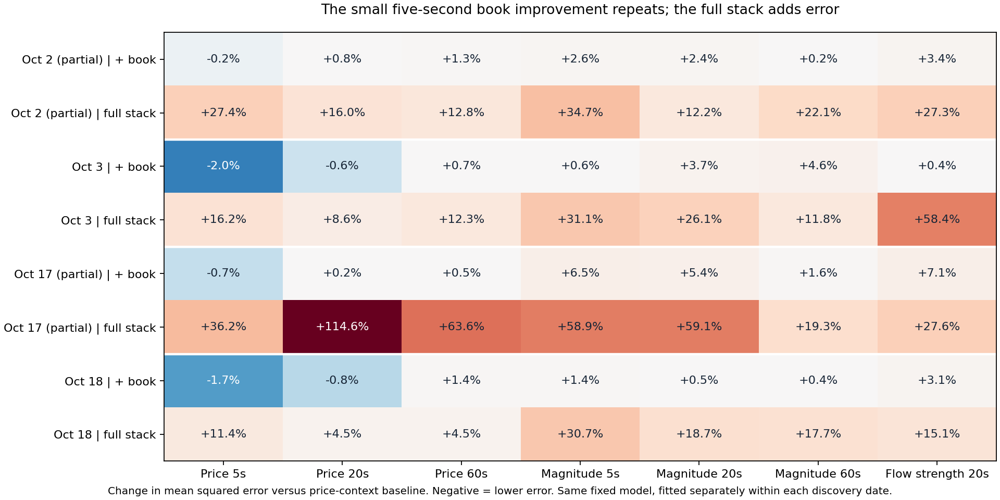

# Four-date application of the October 18 analysis

Completed November 8, 2026 Eastern time. The October 2, 3 and 17 ROOT/Native
runs and standalone touch/print decisions are sealed. This analysis uses their
saved outputs and applies the October 18 dipole, complementary indicator stack,
strict-prebirth, aggression-to-rest and observation-clock calculations.

**The full stack adds error on all four dates in this fixed model. Adding book
information alone gives a small five-second price improvement on all four.**
The latter is inconsistent across within-day time blocks and longer horizons.
All hypotheses, including every weaker combination, remain in the paper handoff.



## Coverage and completion

| Date | Replay scope | Completed groups | All Native dipoles | Live recognitions | Finalization-only | Standalone decision rows |
| --- | --- | ---: | ---: | ---: | ---: | ---: |
| Oct 2 | Partial, UTC snapshot to halt | 600,291 | 741 | 741 | 0 | 118,709 |
| Oct 3 | Full session | 653,912 | 833 | 832 | 1 | 127,052 |
| Oct 17 | Partial, UTC snapshot to halt | 635,170 | 741 | 740 | 1 | 110,500 |
| Oct 18 | Full archived session | 583,688 | 863 | 863 | 0 | Existing reference |

These are the archived Native populations. Claude's separate full-session
raw-tape research has 839/857/830/890 events and a different detector population.
Do not merge those rows or replace the original partial scopes. The October 1/16
prefix repair remains separately documented; it does not change these sealed runs.

The last of the three decision passes finished at 21:12:29 UTC on November 8.
Bulk archive publication and pod shutdown remain owned by the existing heartbeat;
completion of this comparison does not certify that all bulk uploads have finished.

The two finalization-only candidates have null emission group indices and nominal
availability after the final source clock. They are retained in `candidate-inputs`
and the source extracts, and included in retrospective prebirth comparisons. They
have no invented live recognition or model prediction. Their IDs are
`dip-19633-1696366763` and `dip-19647-1697576378`.

## Same calculation, separately fitted by date

The unchanged 11 arms compare price context, dipole shape/strength, fresh
participation, displayed book, fixed-price display changes, combinations and
leave-one-layer-out variants. Price-context inputs are prior 20-second midpoint
movement, its range, and spread. The book layer adds touch size/count imbalance
and total displayed quantity/order counts. These are observations at recognition.

Every date uses the original ridge penalty 10, train-only imputation and scaling,
40/60/80 percent expanding chronological cuts, outcome purge and a 600-second
embargo. Arms use identical rows within a target/fold. The models are fitted
separately within each discovery date: this is recurrence of the method, not a
model trained on October 18 and transferred backward. Seven target/window pairs
times 11 arms times three folds times four dates give 924 fits, without tuning.

The table reports change in pooled chronological-fold mean squared error against
the context baseline. Negative is better; these are not trading returns.

| Date | Evaluated five-second price cases | Book added, price 5s | Full stack, price 5s | Full stack, price 20s | Full stack, price 60s |
| --- | ---: | ---: | ---: | ---: | ---: |
| Oct 2 | 445 | −0.17% | +27.35% | +15.97% | +12.76% |
| Oct 3 | 500 | −2.04% | +16.22% | +8.56% | +12.34% |
| Oct 17 | 444 | −0.73% | +36.20% | +114.62% | +63.60% |
| Oct 18 | 518 | −1.68% | +11.39% | +4.46% | +4.46% |

The full stack is worse in all 28 date/target/window comparisons, including
absolute price movement and subsequent flow-strength change. Book-only five-second
ratios across the three folds are 0.991/0.973/1.101 on Oct 2,
0.979/0.985/0.955 on Oct 3, 1.005/0.987/0.998 on Oct 17, and
0.981/0.972/0.999 on Oct 18. The small pooled improvement is not universal
within a day. At 20 seconds book alone improves Oct 3/18 and worsens Oct 2/17;
at 60 seconds it worsens all four. This describes one fixed linear model and
dependent, selected discovery observations; it does not eliminate the layers.

[Every arm, target and fold](four-date-metrics.csv) ·
[All conditional states](four-date-conditions.csv)

## Weakening flow does not have one price outcome

For the same state—both halves contain classified flow, the later half is weaker,
and displayed book imbalance is aligned with current flow—the 20-second midpoint
outcomes are:

| Date | Cases | With current flow | Against | Flat |
| --- | ---: | ---: | ---: | ---: |
| Oct 2 | 24 | 8 | 7 | 9 |
| Oct 3 | 46 | 20 | 12 | 14 |
| Oct 17 | 29 | 9 | 9 | 11 |
| Oct 18 | 45 | 25 | 12 | 8 |

The Oct 18 skew weakens elsewhere. With book opposed to weakening flow, the
with/against/flat counts are 9/22/7, 7/19/6, 12/13/12 and 15/16/9 respectively.
Opposition is associated with more contrary outcomes on Oct 2/3; it is nearly
balanced on Oct 17/18. Keep both conditional stories and their denominators.

Exact cases from the aligned-book cohort illustrate the different paths. Selection
is retrospective: earliest favorable, contrary and flat example per date. It is
not an additional predictive test. Each date's `conditional-order-examples.json`
retains recognition and first strictly later print groups, all original messages,
order IDs, raw member indices, integer receive clocks and the 20-second endpoint.

- **Oct 2 favorable:** `dip-19632-1696230761`, recognition group 30066.
  The midpoint is two ticks lower at 20 seconds, with the current sell flow.
  At +1.496 seconds, group 30108, cursors 40342–40344, a one-lot buy fills
  ask order `788649954172` at 2.905; the order then displays 19 lots. The
  subsequent print direction and the 20-second outcome differ.
- **Oct 3 contrary:** `dip-19633-1696286641`, recognition group 1632.
  At +7.475 seconds, group 1634, cursors 2601–2604, a three-lot buy fills
  ask order `788652773845` at 2.843 and a linked cancellation removes it.
  The close shows bid 2.842/ask 2.844. At 20 seconds the midpoint is half
  a tick below recognition, against the original buy flow.
- **Oct 17 favorable:** `dip-19647-1697542404`, recognition group 104198.
  At +13.772 seconds, group 104286, cursors 129363–129370, a three-lot buy
  fills three one-lot asks at 3.108 (`788696720536`, `788696720831`,
  `788696721109`); linked cancellations remove them and the ask becomes
  3.109. The 20-second midpoint is 1.5 ticks higher, with current flow.
- **Oct 2 flat:** `dip-19632-1696230564`, recognition group 28817.
  The first later print is +47.223 seconds away, beyond the 20-second target.
  That print cannot explain a within-window execution response. The saved
  endpoint is flat; the print-free interval is part of the evidence.

## Prebirth contrasts and order persistence

The same strict prebirth leads of 1/5/20/60 seconds use only earlier completed
groups, matched to earlier controls with the same spread and activity bucket.
At one second before birth, matched cases are 381/741, 367/833, 379/741 and
487/863, using 176/162/174/220 distinct controls. Every unmatched case remains.
Case-minus-control mean prior-20-second classified quantity is −0.45/−1.15/
−0.82/−0.35 lots; every median difference is zero. Displayed-quantity differences
are −0.46/+1.39/+0.75/+0.57 lots. The changes are small and the display sign does
not repeat on all dates. Control reuse, retrospective birth labels and matching on
activity restrict what these descriptive differences imply.

The original same-order-ID trade-then-add mechanism finds 1,129/1,202/1,010/980
aggression-to-rest paths. Only 323/324/365/349 remain at the 100ms observation
timer. The same mechanism often ends quickly on every date. Fill-linked clears
number 628/736/582/613; clears without a matched fill number 476/435/393/324.
Unmatched removal does not prove a cancellation motive. Each date retains all
actions, endings, timed observations, outcomes, and favorable/contrary/flat order
examples. Observation timers do not simulate entries or fills.

[Prebirth coverage](four-date-prebirth-coverage.csv) ·
[Resting mechanisms](four-date-resting-mechanisms.csv) ·
[Recognition states including undefined flow](four-date-recognition-states.csv)

## Reproduction and checks

- Input groups are pinned to `2f12d6d47` for the new dates and
  `b5f28bd57de5ed4ff889335edb9a33216b67eb6a` for Oct 18. Their SHA256 digests
  match the saved receipts. Source extracts retain the exact candidate, episode
  and flow-substrate records from each completed Native lifecycle ledger; all
  three full ledger hashes were verified during extraction.
- All 2,473,061 group closes across the four dates match the original raw tape's
  cursor, receive clock and F_LAST flag. No producer, exporter or simulator reran.
- Seven Oct 18 result tables reproduce the original values, including the dipole
  prebirth population. Feature availability, identical arm populations, purge,
  embargo, unique IDs and denominator conservation are checked for all dates.
- Four new normalization tests and 20 existing atlas/dipole/stack tests pass.
  The finalization-only test prevents a last-group substitute for a missing live
  recognition. [Verification record](verification.json)

Run from the repository root:

```powershell
python tasks/family-research-20261022/research_replay_comparison.py 20231002 --mechanisms
python tasks/family-research-20261022/trace_replay_comparison.py 20231002
# Repeat both commands for 20231003, 20231017 and 20231018.
python tasks/family-research-20261022/summarize_replay_comparison.py
```

The existing frozen NG timing/runway definitions remain unchanged. The broader
749-family-start four-arm study and external-data repair have different inputs;
this report does not relabel these dipoles as that family population or substitute
one date's missing fields. Preserve the separate full-session research comparisons
and all hypotheses for the next user-directed step. No new paper strategy is chosen.
